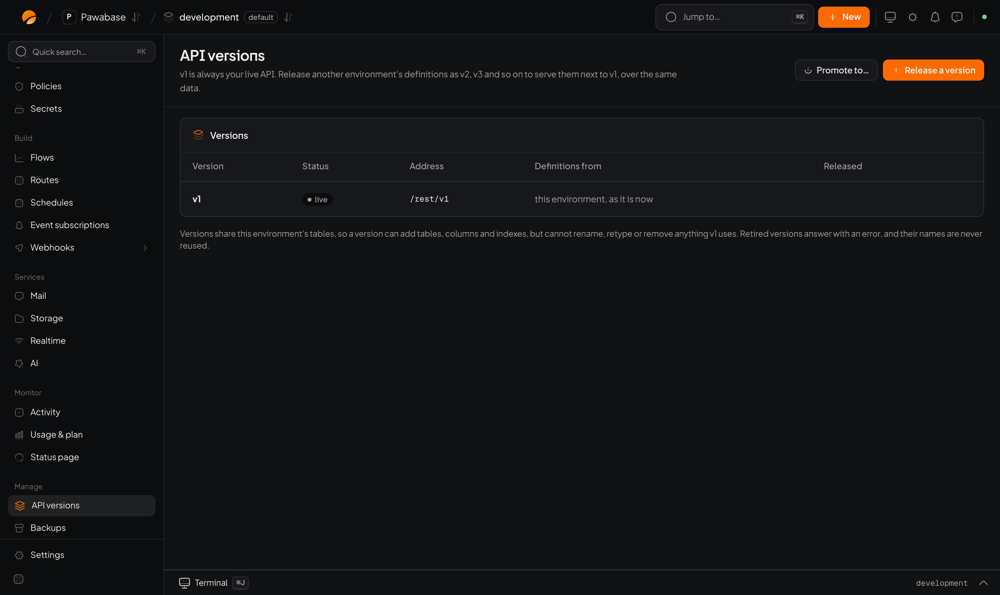

Your live API is **v1**, served at `/rest/v1`. When you want to change how it looks without breaking the apps that use it, release a **new version** next to it. Both run at the same time over the **same tables and data**.

<Frame caption="Project → API versions: v1 is always live.">
  
</Frame>

## Release a version

<Steps>
  <Step title="Build the changes in another environment">
    For example change a resource's fields or routes in `development` or `staging`.
  </Step>
  <Step title="Open Project → API versions → Release a version">
    Choose a name (`v2`, `v3`…) and the environment the definitions come from.
  </Step>
  <Step title="Review what changes">
    Studio shows **Resources added**, **Resources left out**, **Routes added** and **Routes left out**, and any **table additions** that will be made.
  </Step>
  <Step title="Release">
    The new version is served at `/rest/v2` straight away, next to v1.
  </Step>
</Steps>

Apps choose a version by calling its address: `/rest/v1/...` or `/rest/v2/...`.

## Rules for versions

- **Versions share tables.** A new version may *add* tables, columns and indexes, but it cannot rename, retype or remove anything a live version still uses. This keeps old apps safe.
- **A version name is never reused**, even after it is retired.
- **v1 is always the live API.** You can't retire it.

## Retire a version

When no app uses a version any more, **Retire** it. It stops being served, and calls to it get a clear error. Check [Activity](/activity/overview) first to see whether anything still calls it.

## When to use it

- You must change a field's shape for new apps while old apps still depend on it.
- You want to try a new design for your API against real data.

If all of your apps ship together, you usually don't need versions: change the definitions and [promote](/environments/promote).
