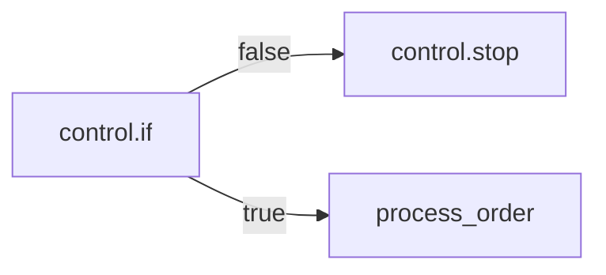
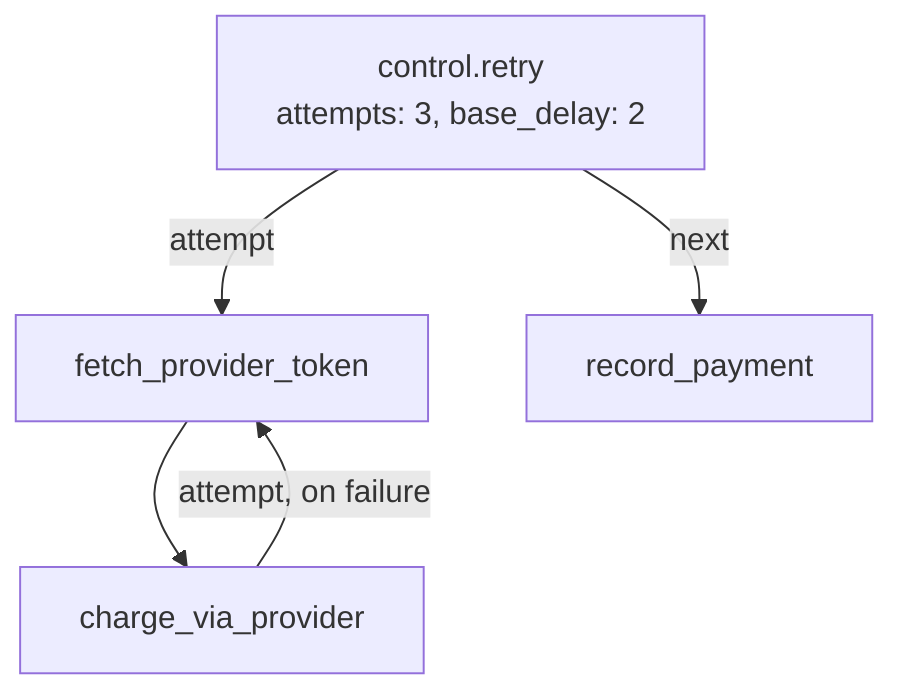
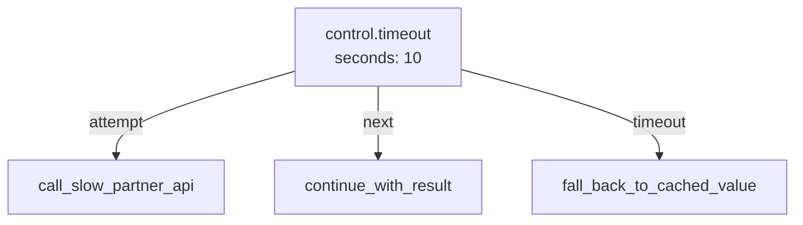
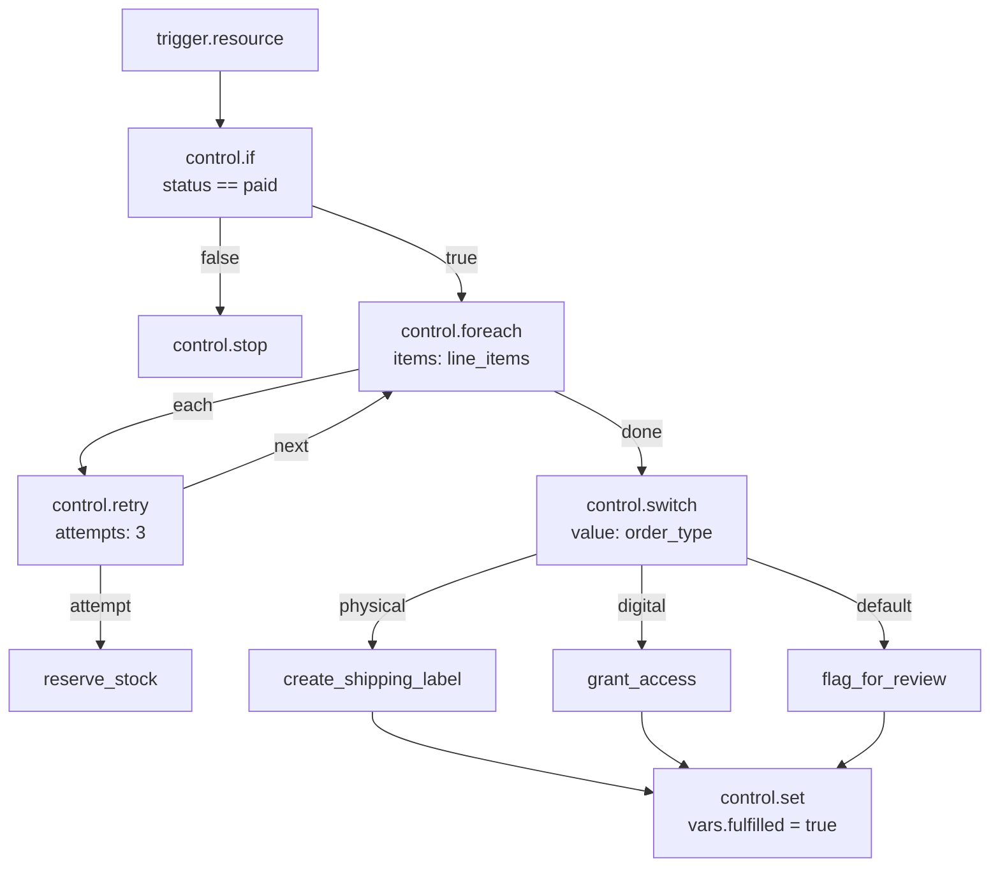

**Purpose.** Pause the run for a fixed number of seconds before continuing.

**Mental model.** A short, in-run pause — not a way to schedule work for later. The run (and, for an HTTP-triggered Flow, the request holding it open) is genuinely waiting the whole time.

**When to use.** Short waits inside a Flow: backing off between polling attempts in a `control.while` body, giving an external system a moment to settle.

**When not to use.** Anything longer than a few seconds, or anything triggered by an HTTP request where the caller shouldn't be kept waiting — dispatch a delayed background job instead of blocking the run.

### Studio configuration

| Field | Type | Required | Default | Description |
| --- | --- | --- | --- | --- |
| `seconds` | number | Yes | — | How long to wait, `0`–`300` |

### Inputs, outputs, handles

- **Output:** the number of seconds waited.
- **Handles:** none declared.

### Execution behavior

The run sleeps for exactly `seconds`. A value above `300` is refused at run time with `delay_too_long` — this is a hard ceiling, not a soft default.

### Examples

```json
{ "seconds": 2 }
```

<Warning>
`control.delay` blocks the current run for its full duration. For an HTTP-triggered Flow, that means the caller's connection stays open the whole time — a `control.delay` inside a request-serving path is rarely what you want. For anything longer than a few seconds, or anything that shouldn't hold a request open, dispatch a delayed background job instead.
</Warning>


## `control.stop` — End the run

**Purpose.** Terminate the run immediately, at this Step, with nothing after it ever executing.

**Mental model.** A dead end, drawn deliberately. Unlike every other control block, `control.stop` has no outgoing Branch at all — Studio won't let you wire anything after it.

**When to use.** Ending a non-HTTP Flow early once its work is done, or once a `control.if` determines there's nothing left to do.

### Studio configuration

`control.stop` takes no configuration fields.

### Inputs, outputs, handles

- **Output:** `null`.
- **Handles:** none. This is the one control block where that's a hard rule enforced by the block itself, not just a convention — draw no edges out of it.

### Execution behavior

The run stops at this Step. If the Flow was triggered over HTTP and no `response.return` Step ran before `control.stop`, the request still receives a response — an empty `200` — because the HTTP layer answers once the run finishes, with whatever the last Step produced (here, `null`).

### Examples



### Troubleshooting

<AccordionGroup>
  <Accordion title="Trying to draw an edge out of control.stop">
    Not possible by design — `control.stop` declares no handles. If you need conditional continuation, put the `control.if` before the point where you'd otherwise stop, and only route the "stop" branch into `control.stop`.
  </Accordion>
</AccordionGroup>


## `control.retry` — Retry a Branch

**Purpose.** Re-run a Branch from the top, with backoff between attempts, until it succeeds or the attempt budget runs out.

**Mental model.** Unlike a single block's own retry option (some HTTP or data blocks retry themselves), `control.retry` retries **everything reachable through its `attempt` Branch** — so it's the right tool when the thing that needs redoing spans more than one Step, such as re-fetching a token before retrying the call that used it.

**When to use.** A multi-step sequence where an early Step's result (a token, a lock, a computed value) might be stale by the time a later Step in the same sequence fails, so simply retrying the last Step isn't enough.

**When not to use.** If only one Step can fail and retrying just that Step is sufficient, check whether that block has its own built-in retry option first — it's simpler than wrapping it in `control.retry`.

### Studio configuration

| Field | Type | Required | Default | Description |
| --- | --- | --- | --- | --- |
| `attempts` | integer | No | `3` | Maximum attempts, 1–10 |
| `base_delay` | number | No | `0.5` | Seconds before the first retry; doubles (with jitter) after that, capped at 30s |

### Inputs, outputs, handles

- **Output:** the `attempt` Branch's last Step's output, from whichever attempt succeeded.
- **Handles:** `attempt` (the Branch that gets retried), `next` (fires once, after a successful attempt).

<Warning>
The handles are `attempt` and `next` — not `next`/`error`. There is no separate `error` handle declared by `control.retry` itself; if every attempt fails, the failure propagates as a normal Step failure at the `control.retry` node, which you can catch with an **error** Branch drawn from that node the same way you would for any other Step (see [Errors and retries](/flows/errors-and-retries)).
</Warning>

### Execution behavior

`control.retry` runs the `attempt` Branch. If it raises, the block waits `base_delay` seconds (doubling, with jitter, on each subsequent attempt, up to a 30-second cap) and runs the whole `attempt` Branch again from its first Step — not just the Step that failed. This continues until an attempt succeeds or `attempts` is exhausted.

### Examples

Simple:

```json
{ "attempts": 5, "base_delay": 1 }
```

Realistic — order fulfillment, re-authenticate and retry a call to a payment provider whose token can expire mid-flow:

```json
{ "attempts": 3, "base_delay": 2 }
```



### Related blocks

`control.timeout`, which bounds how *long* a Branch may run rather than how many *times* it may be retried — the two are often combined, with `control.timeout` wrapping a single attempt and `control.retry` wrapping the timeout.


## `control.timeout` — Bound a Branch's duration

**Purpose.** Run an `attempt` Branch with a deadline; if it doesn't finish in time, follow `timeout` instead of waiting indefinitely.

**Mental model.** A stopwatch on a sub-graph. Unlike `control.delay`, which pauses the run, `control.timeout` races the `attempt` Branch against a clock and takes whichever finishes first.

**When to use.** Any Branch that calls out to something whose latency you don't fully control and where a slow response is worse than a fast, known failure — an external API call, a Branch that itself loops.

### Studio configuration

| Field | Type | Required | Default | Description |
| --- | --- | --- | --- | --- |
| `seconds` | number | Yes | — | Deadline for the `attempt` Branch, `0.001`–`300` |

### Inputs, outputs, handles

- **Output:** on success, the `attempt` Branch's last Step's output. On timeout, `{"timeout_seconds": <seconds>}`.
- **Handles:** `attempt` (the timed Branch), `next` (fires on success), `timeout` (fires if the deadline passes first).

### Execution behavior

If the `attempt` Branch raises an exception for a reason other than timing out, that exception propagates as a normal Step failure at the `control.timeout` node — `timeout` only fires when the deadline itself is what stopped the Branch, not when the Branch fails for some other reason.

### Examples

```json
{ "seconds": 10 }
```



### Related blocks

`control.retry` for repeating a failed attempt rather than bounding a slow one; the two combine well — a `control.retry` whose `attempt` Branch is itself a `control.timeout` gives you both a deadline per try and a retry budget across tries.


## Error Branches: a general mechanism, not a control block

Every Step in a Flow — not just control blocks — can have an outgoing **error** Branch drawn in Studio. When a Step raises and an error Branch exists for it, the run continues down that Branch instead of failing outright; `error.message`, `error.type`, and `error.node` become readable from Step state. When no error Branch exists, the failure propagates and the run fails. This applies to `control.foreach`'s `too_many_items`, `control.while`'s `too_many_iterations`, `control.retry` exhausting its attempts, and any data or platform block's own failures alike. Full details, including how errors interact with `control.retry` and `control.timeout` specifically, are covered in [Errors and retries](/flows/errors-and-retries) — this page only establishes that the mechanism exists and applies uniformly.


## Putting it together: order fulfillment

A realistic Flow combining most of the blocks on this page — triggered by `orders.updated` firing when an order's status changes to `paid` (see [Triggers](/flows/triggers)):



Reading this graph: the trigger fires on every update to an order, but `control.if` stops the run immediately for anything that isn't a payment transition. Each line item is reserved with its own retry budget, so a transient stock-service blip doesn't fail the whole order. Once every item is reserved, `control.switch` routes to the right fulfillment path by order type, and all three paths converge on one `control.set` so anything after this Flow can check `vars.fulfilled` without knowing which path ran.


## Common mistakes

<AccordionGroup>
  <Accordion title="Using {{ }} inside a condition field, or $ inside an Expression field">
    They're different systems. `control.if` and `control.while`'s `condition` field takes `$input.foo`; every other field (`items`, `values`, `objects`, `value`, `seconds`) takes `{{ input.foo }}`.
  </Accordion>
  <Accordion title="Writing neq or nin">
    The operators are `ne` and `not_in`. `neq` and `nin` are not recognized and the Condition is refused when you save.
  </Accordion>
  <Accordion title="Expecting control.foreach to run in parallel">
    It's always sequential; `concurrency` is fixed at `1`. Dispatch a job per item for real parallelism.
  </Accordion>
  <Accordion title="Expecting control.retry's handles to be next/error">
    They're `attempt` and `next`. There's no dedicated `error` handle on the block itself — draw a normal error Branch from the `control.retry` node if you want to catch exhausted retries.
  </Accordion>
  <Accordion title="Drawing an edge out of control.stop">
    It has no handles by design. Route into it, never out of it.
  </Accordion>
  <Accordion title="Expecting control.set to accumulate a list across loop iterations">
    It replaces the named key each time it runs. Build the full value you want in one Expression rather than relying on incremental appends.
  </Accordion>
  <Accordion title="Setting control.while's max_iterations very high while still debugging">
    A stuck loop with `max_iterations: 10000` burns all 10,000 iterations before failing. Keep the limit low during development and raise it once you trust the stopping condition.
  </Accordion>
</AccordionGroup>


## Next

<CardGroup cols={2}>
  <Card title="Triggers" icon="waypoints" href="/flows/triggers">How a Flow starts, and what lands in `input` for each Trigger.</Card>
  <Card title="Errors and retries" icon="triangle-alert" href="/flows/errors-and-retries">The error Branch mechanism, in full, including block-level retry options.</Card>
  <Card title="State" icon="database" href="/flows/state/overview">Everything a Step can read: `input`, `vars`, `steps`, `auth`, `run`.</Card>
  <Card title="Platform blocks" icon="plug" href="/flows/platform-blocks/overview">The blocks that do work — data, mail, HTTP, storage, queues.</Card>
</CardGroup>
