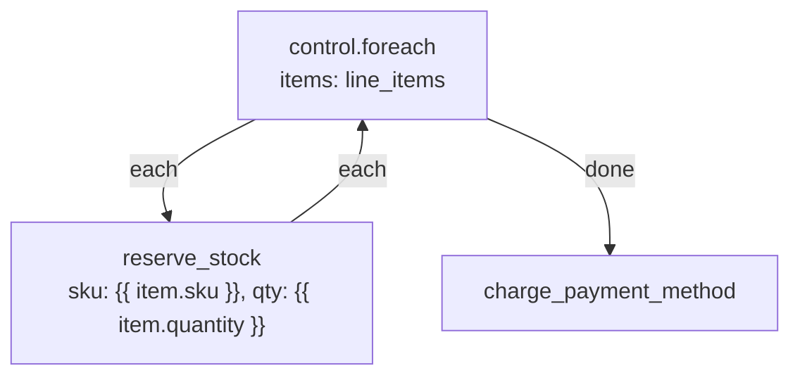
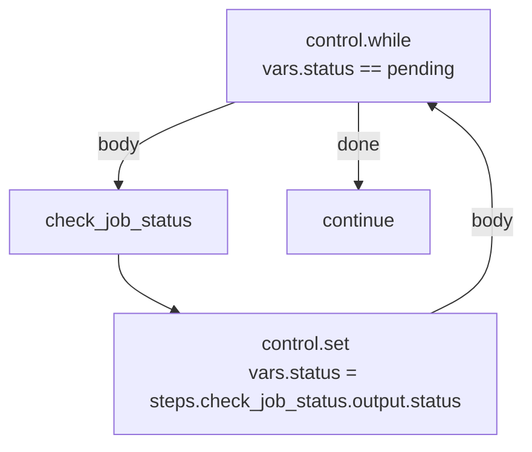

**Purpose.** Run a Branch once for every item in a list, in order.

**Mental model.** A `for` loop. `items` is a list; the `each` Branch runs once per element with that element in scope, then `done` fires once, after the last iteration.

**When to use.** Processing every line item in an order, every recipient in a batch, every record a previous Step fetched.

**When not to use.** Don't reach for `control.foreach` to run something in parallel — see Execution behavior below, it is always sequential. For true concurrency, dispatch one background job per item with a queue block instead of looping inside one run.

### Studio configuration

| Field | Type | Required | Default | Description |
| --- | --- | --- | --- | --- |
| `items` | Expression resolving to a list | Yes | — | The collection to iterate |
| `concurrency` | integer | No | `1` | Reserved; fixed at `1` today (see below) |

### Inputs, outputs, handles

- Inside the `each` Branch, two variables are in scope automatically — **you don't configure their names**: `item` (the current element) and `index` (its zero-based position). Reference them as `{{ item }}` and `{{ index }}`, not `{{ vars.item }}`.
- **Output:** a list of the `each` Branch's last Step's output, one entry per iteration.
- **Handles:** `each` (re-entered once per item), `done` (fires once, after the loop finishes).

### Execution behavior

`items` must render to a list; if it renders to an object, `control.foreach` iterates its `[key, value]` pairs (so `item.0` is the key, `item.1` the value) — but a list is the common and clearer case. A list longer than 10,000 items raises `too_many_items` and the run fails; a `control.foreach` over an unbounded collection should page it first.

The `concurrency` field exists in the schema but is capped at a maximum of `1` — every iteration finishes before the next starts. This is not a rate limit you can raise; there is currently no parallel `control.foreach`.

### Examples

Simple — log each item:

```json
{ "items": "{{ input.body.tags }}" }
```

Realistic — order fulfillment, reserve inventory for each line item before charging:

```json
{ "items": "{{ input.body.line_items }}" }
```



If `reserve_stock` fails for one line item partway through, the loop stops there (see Errors) — the earlier reservations already made are not automatically rolled back. A fulfillment flow that must be all-or-nothing should wrap the `each` Branch in a compensating action, or collect reservations and commit them together once the loop's `done` Branch is reached.

### Building a list for another block

Several blocks (transactional writes, bulk inserts) take a static list rather than looping internally. Build that list first with `control.foreach` + `control.set`, writing into an accumulating `vars` entry inside the loop, then read the finished list from `vars` after `done`:

```
control.foreach (items: {{ input.body.line_items }})
  each → control.set { "values": { "ops": "{{ vars.ops | default:[] }}" } }   # placeholder pattern; see note below
  done → next Step reads {{ vars.ops }}
```

<Note>
`control.set` replaces the named keys with whatever `values` computes — it doesn't append to a list for you. To accumulate across iterations, compute the whole next-state expression yourself (for example, build the full merged list in one Expression using `steps.<node>.output`, which is already the list of the loop's per-iteration outputs) rather than expecting `vars.ops` to grow item by item.
</Note>

### Errors

An exception inside the `each` Branch stops the loop at that iteration (the engine's normal error handling applies — see [Errors and retries](/flows/errors-and-retries)); it does not roll back completed iterations and does not continue to remaining items unless the failing Step itself has an **error** Branch that returns the loop to a safe continuation point.

### Troubleshooting

<AccordionGroup>
  <Accordion title="`items` isn't a list error">
    `control.foreach` needs a real list at run time. `{{ steps.fetch.output }}` needs the previous Step to actually return a list — check its output shape, not just that the field exists.
  </Accordion>
  <Accordion title="`{{ item.name }}` is empty inside the loop">
    Confirm each element of `items` is an object with a `name` key, not a bare string or number. `control.foreach` doesn't reshape elements — `item` is exactly whatever was in the list.
  </Accordion>
  <Accordion title="Expecting concurrency to speed up a large loop">
    It won't — `concurrency` is fixed at `1`. A loop over thousands of items runs one at a time; for throughput, dispatch a job per item instead of looping in one run.
  </Accordion>
</AccordionGroup>


## `control.while` — Loop while a condition holds

**Purpose.** Run a `body` Branch repeatedly for as long as a Condition is true, evaluated fresh before every iteration.

**Mental model.** A `while` loop. Unlike `control.foreach`, there's no fixed collection — the loop keeps going until something inside the body (typically a `control.set`) changes the state so the Condition stops being true.

**When to use.** Polling for a status to change, paginating through an API until there's no next page, retrying a computation until a threshold is reached. Anywhere the number of iterations isn't known ahead of time.

**When not to use.** If you already have the full list to process, `control.foreach` is simpler and safer — it can't loop forever. Reach for `control.while` only when the stopping condition is genuinely data-dependent.

### Studio configuration

| Field | Type | Required | Default | Description |
| --- | --- | --- | --- | --- |
| `condition` | Condition | Yes | — | Re-evaluated before every iteration |
| `max_iterations` | integer | No | `1000` | Safety limit, 1–10,000 |

### Inputs, outputs, handles

- **Output:** a list of the `body` Branch's last Step's output, one per iteration.
- **Handles:** `body` (re-entered while the Condition is true), `done` (fires once the Condition is false, or the loop stops).

### Execution behavior

Before each iteration, the Condition is evaluated against the *current* state — so a `control.set` inside `body` that changes the value the Condition reads is what normally ends the loop. If the loop reaches `max_iterations` without the Condition going false, the run fails with `too_many_iterations` — this is a safety net against an infinite loop, not a normal exit path. Set `max_iterations` deliberately low while you're building a `control.while` so a bug fails fast in testing rather than burning 1,000 iterations first.

### Examples

Simple — poll until a flag flips (paired with `control.delay` so it doesn't spin):

```json
{ "condition": { "eq": ["$vars.status", "pending"] }, "max_iterations": 20 }
```



Realistic — order fulfillment, paginate a supplier API until all pages are fetched:

```json
{ "condition": { "truthy": "$vars.next_page" }, "max_iterations": 50 }
```

### Errors

`too_many_iterations` fails the run like any other error — give the `control.while` Step an **error** Branch if a stalled loop should be handled gracefully (notify someone, mark the record for manual follow-up) rather than failing the whole Flow.

### Related blocks

`control.foreach` for a known collection; `control.delay` inside the body to avoid a tight polling loop; `control.retry` when the thing that might need repeating is "this one Step failed," not "this condition hasn't changed yet."


## `control.set` — Set variables

**Purpose.** Write one or more values into `vars`, readable by every later Step in the same run — including Steps in a different Branch than the one that set them.

**Mental model.** The only way data crosses from one Branch to another without threading `steps.<name>.output` references through every downstream field. It's also how two branches of a `control.if` or `control.switch` converge on one variable name.

**When to use.** Sharing a computed value across branches; giving a value a stable, readable name instead of a long `steps.*` path; building up a value across a loop's iterations.

### Studio configuration

| Field | Type | Required | Default | Description |
| --- | --- | --- | --- | --- |
| `values` | Expression object | Yes | — | A map of variable name → value. Each value may itself be an Expression |

### Inputs, outputs, handles

- **Output:** the rendered `values` object.
- **Handles:** none declared — `control.set` has a single default continuation, like any block with no branching.

### Execution behavior

`values` is rendered and merged into `vars` — existing keys not named in `values` are untouched; keys named in `values` are replaced outright, not appended to or deep-merged.

### Examples

Simple:

```json
{ "values": { "greeting": "Hi {{ input.body.name }}," } }
```

Realistic — order fulfillment, stash a computed total for every later Step to reuse:

```json
{ "values": { "grand_total": "{{ steps.compute_totals.output.subtotal }}", "currency": "USD" } }
```

<Tip>
`control.set` is the idiomatic way to make two branches of a `control.if` converge on one variable name, rather than a downstream Step conditionally reading `steps.branch_a.output` in one case and `steps.branch_b.output` in the other.
</Tip>

### Troubleshooting

<AccordionGroup>
  <Accordion title="A variable set inside a loop or branch doesn't have the value I expect afterward">
    `vars` is shared, run-wide state — the last write wins across the whole run, in execution order, not per-branch. If two branches both write `vars.status`, whichever one runs last (or, in a loop, whichever iteration runs last) is what later Steps see.
  </Accordion>
  <Accordion title="Expected values to accumulate into a list">
    They don't automatically — see the `control.foreach` section above. `control.set` replaces the key each time it runs; build the full desired value in one Expression instead of relying on incremental writes.
  </Accordion>
</AccordionGroup>


## `control.merge` — Merge objects

**Purpose.** Combine several objects into one, later entries winning on key collisions.

**Mental model.** `Object.assign` across a list — useful for assembling one request body or one record from data that lives in several Steps' outputs.

**When to use.** Building a payload for an outbound HTTP call or a write, where the pieces come from different upstream Steps (metadata from one, computed fields from another, a constant from a third).

### Studio configuration

| Field | Type | Required | Default | Description |
| --- | --- | --- | --- | --- |
| `objects` | Expression (array of objects) | Yes | — | Objects to merge, left to right |

### Inputs, outputs, handles

- **Output:** the merged object.
- **Handles:** none declared.

### Execution behavior

Each entry of `objects` is rendered; non-object entries (a rendered value that isn't a JSON object) are skipped rather than raising. Keys from later entries overwrite the same key from earlier entries.

### Examples

```json
{
  "objects": [
    { "org_id": "{{ auth.org }}" },
    { "status": "processed" },
    "{{ steps.metadata.output }}"
  ]
}
```

Realistic — order fulfillment, assemble a shipping label request from three sources:

```json
{
  "objects": [
    "{{ steps.fetch_order.output.shipping_address }}",
    { "carrier": "{{ vars.selected_carrier }}" },
    { "reference": "{{ input.body.order_id }}" }
  ]
}
```

### Related blocks

`control.set` when you only need to name one value, not combine several; `control.foreach` output is already a list, and is a common `objects` source when you want the merged result of every iteration's Step.


## `control.noop` — Do nothing

**Purpose.** Continue to the next Step without changing state, calling a service, or producing a value.

**When to use.** Leave a deliberate placeholder while building a Flow, or make one path of a conditional explicit before it joins a later Step.

`control.noop` has no configuration. Its output is `null` and it has the normal `next` handle, so any edge connected after it continues exactly as usual.
