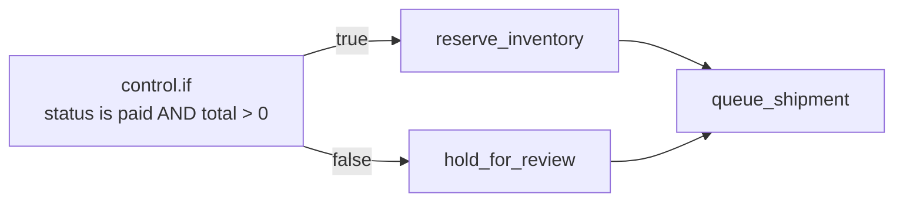
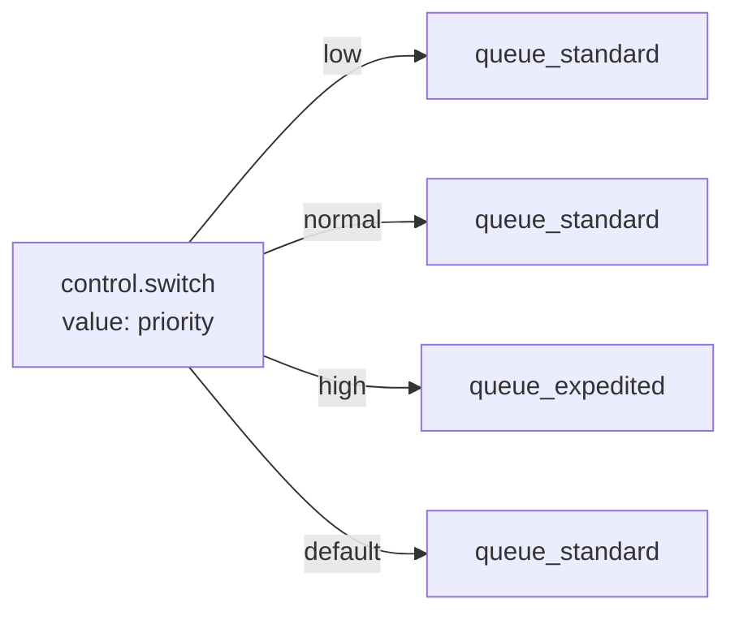

Control blocks don't talk to your database, send mail, or call an external API. They decide **which path** a run takes, **how many times** a Branch repeats, and **when** a run ends. Every other kind of block — data, mail, HTTP, storage — does work; control blocks decide whether and how often that work happens.

In Studio, control blocks live in the **Control** category of the block palette. A Flow is built by wiring a Trigger to a sequence of Steps, and control blocks are the Steps that fork that sequence into more than one path (`control.if`, `control.switch`), repeat a path (`control.foreach`, `control.while`), or end it early (`control.stop`).

<CardGroup cols={3}>
  <Card title="Branching" icon="code-branch">`control.if`, `control.switch` — choose a path.</Card>
  <Card title="Looping" icon="rotate">`control.foreach`, `control.while` — repeat a Branch.</Card>
  <Card title="Data & timing" icon="sliders">`control.set`, `control.merge`, `control.noop`, `control.delay`, `control.stop`, `control.retry`, `control.timeout`.</Card>
</CardGroup>

## Mental model: the run's state

Every Flow run carries one piece of state that every Step can read and that Studio's field pickers browse:

| Key | What it holds |
| --- | --- |
| `input` | The payload the Trigger produced. Shape depends on which Trigger fired — see [Triggers](/flows/triggers). |
| `vars` | Whatever `control.set` has written so far. Empty until the first `control.set` runs. |
| `steps` | Every Step's own output and handle, keyed by the Step's name — `steps.<step>.output`, `steps.<step>.handle`. |
| `auth` | The caller's identity: `auth.authenticated`, `auth.user_id`, `auth.roles`, and so on. |
| `run` | `run.id` and `run.flow` — metadata about this execution, not your data. |
| `error` | Set only after a Step fails into an **error** Branch (see below). Holds `error.message`, `error.type`, `error.node`. |

Control blocks are the only blocks that write to this state directly (`control.set` writes `vars`) or read it to make a decision (`control.if`, `control.switch`, `control.while`). Every other block reads and writes through its own inputs and outputs.


## Two ways to reference state: Expressions and Conditions

Studio gives you two related but distinct syntaxes, and mixing them up is the single most common mistake on this page.

### Expressions — `{{ path }}`

Most fields — a path string, a list of items, an object of values — take an **Expression**: a double-curly-brace lookup into the run's state, with optional filters.

```
{{ input.body.email }}
{{ steps.fetch_order.output.total }}
{{ vars.greeting }}
{{ input.body.amount | default:0 }}
```

A field value that is *entirely* one Expression (nothing before or after the `{{ }}`) returns the looked-up value itself — a list stays a list, an object stays an object. A field value with text around an Expression is rendered as a string, with the Expression's value spliced in and lists/objects turned into JSON text.

Supported filters, applied left to right with `|`:

| Filter | Effect |
| --- | --- |
| `default:<value>` | Substitutes `<value>` when the looked-up value is `null` or `""` |
| `upper` / `lower` | Uppercases / lowercases a string |
| `json` | Serializes the value as a JSON string |
| `length` | The length of a string, list, or object |
| `int` / `float` / `str` / `bool` | Type coercion |
| `first` / `last` | The first / last element of a list |
| `keys` | The keys of an object, as a list |

Example: `{{ input.body.amount | default:0 | float }}`.

### Conditions — JSON with `$path` operands

`control.if` and `control.while` don't take an Expression for their condition — they take a **Condition**: a JSON object built from one operator. A Condition is evaluated directly against the run's state; operands starting with `$` are paths into that state, everything else is a literal.

```json
{ "eq": ["$input.body.status", "paid"] }
```

```json
{
  "all": [
    { "authenticated": true },
    { "gt": ["$input.body.total", 100] }
  ]
}
```

| Kind | Operators |
| --- | --- |
| Comparison | `eq`, `ne`, `gt`, `gte`, `lt`, `lte`, `in`, `not_in`, `contains`, `starts_with`, `ends_with`, `matches` |
| Combinators | `all`, `any`, `not` |
| Unary | `exists`, `truthy`, `empty` |
| Shorthands | `authenticated`, `role`, `permission`, `owner`, `service`, `kind`, `scope`, `aal` |

<Warning>
Condition operators are `ne` and `not_in` — not `neq` or `nin`. Combinators are `all` / `any` / `not` — there is no `and` or `or` operator. A Condition typed with the wrong operator name is refused when you save the Flow.
</Warning>

A comparison takes exactly two operands, `[left, right]`. `all` and `any` take a list of Conditions. `not` takes one Condition. `exists`, `truthy`, and `empty` take a single operand — `{"truthy": "$input.body.name"}` is true when that path resolves to a non-empty, non-zero, non-false value.

The shorthands expand to a full Condition using `$auth` and `$record` paths — for example `{"role": "admin"}` expands to checking `$auth.roles` contains `"admin"`. They exist for policies (who may call an endpoint) as much as for `control.if`, so you'll see the same vocabulary in [Policies](/policies/overview).

<Tip>
Rule of thumb: Studio's **condition** widget (the one with an operator dropdown) wants `$input.foo`. A plain text field wants `{{ input.foo }}`. If a field shows a "Condition" builder UI rather than a text box, it's the JSON form.
</Tip>


## `control.if` — Branch on a condition

**Purpose.** The workhorse of branching: evaluate one Condition, take one of two paths.

**Mental model.** A fork in the road with exactly two exits. Draw one Branch from the `true` exit and one from the `false` exit; both are optional, and both may reconverge on the same later Step.

**When to use.** Any binary decision: "is this order paid?", "does this user have a role?", "is the field present?". When you need more than two outcomes from a single value, use `control.switch` instead — chaining several `control.if` blocks to test the same field against different values works but reads worse and is harder to change.

**When not to use.** Don't use `control.if` to validate input and produce an error response — that belongs in a policy or a schema on the Trigger, evaluated before the Flow runs at all. Reserve `control.if` for decisions that depend on data only the Flow itself computes (a previous Step's output, a computed total).

### Studio configuration

| Field | Type | Required | Default | Description |
| --- | --- | --- | --- | --- |
| `condition` | Condition | Yes | — | The Condition to evaluate against the run's state |

### Inputs, outputs, handles

- **Reads:** the run's entire state (`input`, `vars`, `steps`, `auth`), through whatever paths the Condition names.
- **Output:** the boolean result of the Condition.
- **Handles:** `true`, `false`. Exactly one fires per run.

### Execution behavior

The Condition is evaluated once, synchronously, against the state as it exists when this Step runs — not against a snapshot taken earlier in the Flow. `null`, `0`, `""`, `false`, and empty lists/objects are all falsy for `truthy`/`empty`; everything else is truthy.

### Examples

Simple — gate a Step on whether a field was supplied:

```json
{ "condition": { "truthy": "$input.body.email" } }
```

Realistic — order fulfillment, branch on payment status before shipping:

```json
{
  "condition": {
    "all": [
      { "eq": ["$input.body.status", "paid"] },
      { "gt": ["$input.body.total", 0] }
    ]
  }
}
```



Both branches reconverging on `queue_shipment` is normal — a Step can have any number of incoming Branches.

### A common pattern: converging on one variable name

Rather than have downstream Steps conditionally reference `steps.branch_a.output` in one case and `steps.branch_b.output` in the other, have both branches of a `control.if` write to the same `vars` key with `control.set`, then have the downstream Step read `{{ vars.greeting }}` regardless of which branch ran:

```
true  branch → control.set { "values": { "greeting": "Hi {{ input.body.name }}," } }
false branch → control.set { "values": { "greeting": "Hi there," } }
                    ↓ both converge on →
              mail.send { "body": "{{ vars.greeting }}" }
```

### Errors

`control.if` itself doesn't raise — a malformed Condition (unknown operator, wrong operand count) is refused when you save the Flow in Studio, not at run time. The only run-time failure is a Condition that references a path that doesn't exist, which simply resolves to `null` (falsy), not an error.

### Troubleshooting

<AccordionGroup>
  <Accordion title="The condition always takes the false branch">
    Check whether you used `{{ input.foo }}` (an Expression) instead of `$input.foo` (a Condition path) inside the `condition` field. A literal string `"{{ input.foo }}"` compared with `eq` will never equal your expected value, because it isn't being resolved as a path.
  </Accordion>
  <Accordion title="Comparing a number field always fails">
    Values arriving from an HTTP body are already the right JSON type (numbers stay numbers), but values built from other Expressions can end up as strings. Compare with `eq` (which normalizes ids) for identity checks, or coerce first with a `control.set` step using the `int`/`float` filter.
  </Accordion>
</AccordionGroup>


## `control.switch` — Branch on a value

**Purpose.** Multi-way branching: evaluate one value, follow the Branch whose name matches it, or fall through to `default`.

**Mental model.** A dispatcher. `value` is rendered to a value, and Studio wires up one Branch per expected case plus a `default` Branch for anything else.

**When to use.** Routing on a status string, a priority level, a plan tier, or any field with a small, known set of values. Prefer this over stacking `control.if` blocks once you have three or more outcomes for the same field.

**When not to use.** When the set of outcomes is genuinely just two, `control.if` is more direct — a two-armed switch adds a `default` Branch with nothing to catch.

### Studio configuration

| Field | Type | Required | Default | Description |
| --- | --- | --- | --- | --- |
| `value` | Expression (string) | Yes | — | Rendered once; its result picks the Branch |
| `cases` | array of strings | No | — | The expected values. Each becomes a named Branch in Studio |

### Inputs, outputs, handles

- **Output:** the rendered value of `value`.
- **Handles:** one per entry in `cases`, plus `default`. If `cases` is left empty, the Branch taken is named by the rendered value itself, whatever it is — useful when the possible values aren't known ahead of time and you only care about a couple of them (wire those, and let everything else flow into `default`).

### Execution behavior

`value` is rendered, then compared as a string against each entry of `cases`. The first (and only) match wins; ties can't happen because `cases` names distinct Branches. Anything that matches no listed case follows `default`.

### Examples

Simple — route by priority:

```json
{ "value": "{{ input.body.priority }}", "cases": ["low", "normal", "high"] }
```



Realistic — order fulfillment, route to a fulfillment path by order type:

```json
{ "value": "{{ input.body.order_type }}", "cases": ["digital", "physical", "subscription"] }
```

- `digital` → grant access immediately, skip shipping entirely
- `physical` → reserve inventory, create a shipping label
- `subscription` → enroll in the billing schedule
- `default` → flag for manual review — an order type Studio doesn't recognize shouldn't silently take one of the known paths

### Related blocks

`control.if` for two-way decisions; `control.foreach` when you need to process a *list* of values rather than branch once on a single one.

### Troubleshooting

<AccordionGroup>
  <Accordion title="Every case falls through to default">
    `cases` holds strings, and `value` is compared as a string. A numeric `input.body.priority` of `1` won't match a case string `"1"` unless you coerce it — wrap `value` with the `str` filter: `{{ input.body.priority | str }}`.
  </Accordion>
  <Accordion title="Adding a new case doesn't create a new Branch automatically">
    Add the value to `cases` first, save, then wire the new Branch in the graph — Studio only offers a Branch handle for entries present in `cases` (or the fallthrough behavior when `cases` is empty).
  </Accordion>
</AccordionGroup>
