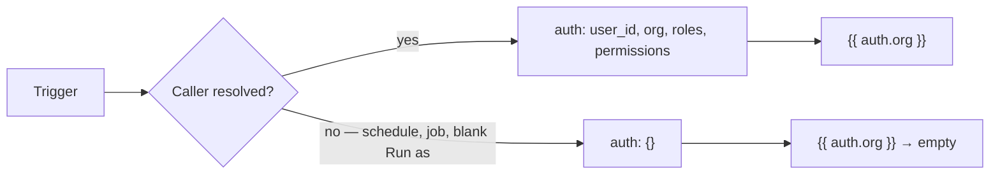

Every Flow run carries a single pool of data forward as it moves from block to block. A trigger populates part of it, `control.set` adds to it, and every finished Step adds its output to it. This page is about that pool: what's in it, how it fills up as a run progresses, and how a template like `{{ steps.load_order.output.total }}` actually finds the value it names.

Understanding this is the difference between guessing why a block didn't get the value you expected, and reading a run's trace and knowing exactly where to look.

<CardGroup cols={2}>
  <Card title="input" icon="arrow-right-to-line">What the Trigger handed the run. Never missing — an empty request still arrives as `{}`.</Card>
  <Card title="auth" icon="shield-check">Who's calling, if anyone. Empty for scheduled and background runs.</Card>
  <Card title="vars" icon="tag">Values you set yourself with a Set variables Step, for passing data across branches.</Card>
  <Card title="steps" icon="list-tree">Every finished Step's output, keyed by its Step ID.</Card>
</CardGroup>

## The namespaces available during a run

A Flow's data lives in a handful of named namespaces. Every one of them is reachable from any block's configuration, in a template:

| Namespace | Where it comes from | Present from the start? |
| --- | --- | --- |
| `input` | The Trigger that started this run | Yes — always, even if empty |
| `auth` | The caller's identity, resolved before the first Step runs | Yes — `{}` when there's no caller |
| `vars` | Values written by Set variables Steps (and a couple of others, noted below) | Yes — starts empty |
| `steps` | Every finished Step's output and the handle it returned, keyed by Step ID | Yes — starts empty, fills in as Steps finish |
| `project`, `env` | Which project and environment this run belongs to | Yes — set once, for the whole run |
| `run` | Identifying details about this particular run: its ID, the Flow's name, and (for API-triggered runs) a request ID | Yes — set once, for the whole run |
| `error` | Details about the most recent error an Error handle caught | Only after the first Error handle fires — see below |
| `item`, `index` | The current element and position inside a For each loop body | Only inside that loop's body |

A couple of things that are *not* in this list, on purpose, because a Studio user never reaches for them directly:

- **Which Step is currently running**, and **how many Steps have run so far** — the engine tracks both internally (to enforce the run's step limit and to label loop/retry bodies), but neither is a value your templates can read. You see the equivalent information in the trace instead: every executed Step lists its own ID and its position in the run.
- **Whether the run has been stopped** by a Stop block — again, this drives the engine's own walk of the graph, not something a template reads.

If you're looking for "how far has this run gotten," the trace is the place to look — covered in [Runs and testing](/flows/runs-and-testing) — not a state value.


## How a template finds a value

A configuration field like

```json
{ "body": "{{ steps.load_order.output.total }}" }
```

is a **path lookup**, not a search. `steps.load_order.output.total` is read as a chain of dotted segments — `steps`, then `load_order` inside that, then `output`, then `total` — walking straight down the namespaces above. There's no fallback order across `input`, `auth`, `vars` and so on: you always name the exact namespace you mean, and the engine walks down from there. `{{ vars.discount_rate }}` reads `vars`, then `discount_rate` inside it. `{{ steps.a.output }}` reads `steps`, then `a`, then `output`. Nothing implicit happens beyond that single walk.

The same dotted-path reading is used in two places that look slightly different on the surface:

- Inside `{{ }}` in a block's configuration — this is the syntax you'll use in nearly every field.
- Inside a Condition (an If, a While, a Switch's underlying comparisons) written against a `$`-prefixed path, e.g. `{"eq": ["$input.status", "paid"]}`. The `$path` form and the `{{ path }}` form read the exact same namespaces the exact same way; `$` is just the shorthand a Condition's JSON uses instead of double braces.

### Filters

A template can pipe its looked-up value through one or more filters, separated by `|`:

```
{{ steps.load_order.output.total | default:0 }}
{{ input.body.email | lower }}
{{ vars.items | length }}
```

| Filter | Does |
| --- | --- |
| `default:<value>` | Substitutes `<value>` when the looked-up value is `null` or an empty string |
| `upper` / `lower` | Uppercases / lowercases a string |
| `json` | Serializes the value as a JSON string |
| `length` | The length of a string, list, or object |
| `int` / `float` / `str` / `bool` | Type conversion |
| `first` / `last` | The first / last element of a list |
| `keys` | The list of an object's keys |

### A whole-value template returns the value itself

A configuration field that is *entirely* one template — nothing before or after the `{{ }}` — returns the underlying value with its real type intact:

```json
{ "items": "{{ input.body.items }}" }
```

If `input.body.items` is a list of objects, `items` receives that list of objects — not a stringified version of it. This is what lets `resource.create`'s `data` field, or `control.foreach`'s `items` field, take a whole object or array straight out of state.

A template *embedded* inside a longer string, on the other hand, always becomes text:

```json
{ "message": "Order {{ steps.load_order.output.id }} totals {{ steps.load_order.output.total }}" }
```

Here each `{{ }}` is replaced with the value's string form (objects and lists are rendered as JSON text) and stitched into the surrounding string.

### A path that doesn't exist

If any segment of the path is missing — the object doesn't have that key, the list is shorter than the index, or an earlier segment was never set — the lookup simply comes up empty. Nothing raises, and nothing marks the run as failed for it.

- In a whole-value template, the field becomes `null`.
- Embedded in a longer string, the missing piece becomes an empty string, silently.

This is worth remembering, because it means a typo in a path — `steps.load_oder.output.total`, `input.boyd.email` — doesn't announce itself as an error. The block downstream simply receives `null` or a blank string and fails (or, worse, silently does the wrong thing) further along. When a Step's behavior doesn't match what you configured, checking the exact spelling of every path it reads is the first thing to try — the [trace](/flows/runs-and-testing) will show you the value each Step actually received.

### Conditions and the `$path` shorthand in full

Every Condition — the setting on an If, a While, or the comparisons you can build against a Switch's value — is a small JSON structure whose operands are `$`-prefixed paths into the same namespaces described above. The full comparison and logical vocabulary:

| Operator | Shape | True when |
| --- | --- | --- |
| `eq` | `{"eq": [a, b]}` | `a` equals `b` |
| `ne` | `{"ne": [a, b]}` | `a` does not equal `b` |
| `gt` / `gte` | `{"gt": [a, b]}` | `a` is greater than (or equal to) `b` |
| `lt` / `lte` | `{"lt": [a, b]}` | `a` is less than (or equal to) `b` |
| `in` / `not_in` | `{"in": [a, list]}` | `a` is (or isn't) a member of `list` |
| `contains` | `{"contains": [list, value]}` | `list` contains `value` |
| `starts_with` / `ends_with` | `{"starts_with": [a, prefix]}` | string `a` starts (or ends) with `prefix` |
| `matches` | `{"matches": [a, pattern]}` | string `a` matches a regular expression |
| `exists` | `{"exists": "$path"}` | the path resolves to something other than empty |
| `truthy` | `{"truthy": "$path"}` | the path resolves to a value that isn't `false`, `0`, `null`, or empty |
| `empty` | `{"empty": "$path"}` | the opposite of `truthy` |
| `all` / `any` | `{"all": [cond, cond, ...]}` | every / at least one child condition is true |
| `not` | `{"not": cond}` | the child condition is false |

```json
{
  "all": [
    { "eq": ["$input.body.status", "paid"] },
    { "gt": ["$input.body.total", 100] },
    { "not": { "empty": "$steps.get_customer.output.email" } }
  ]
}
```

Each `$path` operand is read exactly the same dotted-path lookup used everywhere else in this page — `$input.body.total` reads `input`, then `body`, then `total`, and a missing segment resolves the same empty way a `{{ }}` template does.

<Tip>
A record-level access policy (used by **Check policy**, and by a resource's own read/write policies) adds a further set of shorthand operators — `authenticated`, `role`, `permission`, `owner`, and a few others — that expand into `eq`/`any`/`all` conditions against `auth` and `credential` automatically. Those are covered where policies are documented; a plain Condition on an If, While, or Switch inside a Flow only ever needs the table above.
</Tip>

### Nested access: objects, lists, and mixed paths

A path segment can also be a list index, written as a plain number:

```json
{ "sku": "{{ input.body.line_items.0.sku }}" }
```

`input.body.line_items.0.sku` walks `input`, then `body`, then `line_items` (a list), then index `0` inside it, then `sku` on that element. Any depth of nesting is fine, as long as each segment matches the actual shape underneath it — a numeric segment against something that isn't a list, or a name segment against something that isn't an object, resolves the same empty way a missing key does. There's no special syntax for "the last item of a list" inside a path itself; use the `last` filter for that instead (`{{ input.body.line_items | last }}`).


## `input` — what the Trigger handed the run

`input` is populated once, before the first Step runs, by whichever Trigger started this execution. Its shape depends entirely on the Trigger type:

| Trigger | `input` shape |
| --- | --- |
| HTTP request | `{ body, params, query, headers }` |
| Event | The event envelope: `{ event: { name, payload, id, source, actor, occurred_at, request_id } }` |
| Schedule | `{ schedule, fired_at, previous_run }` |
| Webhook | `{ body, headers, params }` |
| Realtime message | `{ channel, event, data }` |
| Background job | `{ job_id, payload, schedule }` |
| Manual (Studio's test panel) | Whatever JSON you typed into the Input box |
| Resource change | `{ event: { name, payload: { resource, change, record }, id, source, occurred_at } }` |

`input` is never absent — an HTTP request with no body still arrives as `input.body == {}`, not `null`. This is the only path data enters a Flow from the outside; everything else in `vars` and `steps` is derived from `input`, directly or indirectly, by the Steps that run.

```json
{ "id": "load_order",
  "data": { "block": "resource.get",
            "config": { "resource": "orders", "id": "{{ input.params.order_id }}" } } }
```

When a request arrives at a route with an `:order_id` path segment, that value is at `input.params.order_id`. A Stripe-style webhook's JSON body lands in `input.body`, and its nested fields follow from there — `input.body.data.object.id`, and so on.

### `input` for each Trigger type, in detail

**HTTP request.** A Flow behind a route sees the full request shape:

```json
{
  "body": { "email": "a@example.com", "plan": "pro" },
  "params": { "id": "acct_42" },
  "query": { "referrer": "landing" },
  "headers": { "user-agent": "..." }
}
```

Path segments declared on the route (`/accounts/:id`) land in `params`; the query string lands in `query`; a JSON request body lands in `body`. All four keys are always present, even if empty.

**Event.** A Flow triggered by a platform or custom event sees the event envelope, not just the payload:

```json
{
  "event": {
    "name": "order.created",
    "payload": { "order_id": "ord_1", "total": 49.99 },
    "id": "evt_8f2c",
    "source": "resources",
    "actor": "usr_abc",
    "occurred_at": "2026-09-30T14:02:11Z",
    "request_id": "req_xyz"
  }
}
```

The event's own data is under `input.event.payload` — `{{ input.event.payload.order_id }}` — while `input.event.name` is the event's name string, useful if one Flow is configured to react to more than one event pattern and needs to branch on which one actually fired. The full envelope is always nested under `input.event`, not at the top level of `input`.

**Schedule.** A Flow triggered on a timer sees:

```json
{ "schedule": "0 * * * *", "fired_at": "2026-09-30T14:00:00Z", "previous_run": "2026-09-30T13:00:00Z" }
```

`previous_run` is `null` the very first time a schedule fires. This is the shape to reach for when a scheduled Flow needs to process "everything since it last ran."

**Webhook** (an inbound delivery from an external service through a configured webhook endpoint) mirrors the HTTP shape, minus route parameters: `{ body, headers, params }`.

**Resource change.** A Flow triggered by a record being created, updated, or deleted sees:

```json
{
  "event": {
    "name": "orders.updated",
    "payload": {
      "resource": "orders",
      "change": "updated",
      "record": { "id": "ord_1", "status": "shipped" }
    },
    "id": "evt_9c2a",
    "source": "resources",
    "occurred_at": "2026-09-30T14:05:00Z"
  }
}
```

`input.event.payload.record` is the record's current state after the write; `input.event.payload.change` indicates which operation occurred (`created`, `updated`, or `deleted`). For updates, comparing against a previous value requires the Flow to fetch the record before the change (e.g. by storing it in a variable beforehand), since the resource-change trigger only carries the post-write state — see [triggers → `trigger.resource`](/flows/triggers#trigger-resource---data-change-reactions) for the full details.

**Manual** (Studio's test panel). Whatever JSON you typed into the **Input** field on the Run tab, unchanged — this is the one Trigger type where `input`'s shape is entirely up to you, which is why it's worth shaping your manual test input to match whatever a real Trigger of the same kind would actually produce.


## `auth` — who's calling, if anyone

`auth` is resolved by the engine before the first Step runs, from however the caller was authenticated:

```json
{
  "user_id": "usr_abc123",
  "org": "org_xyz",
  "roles": ["admin", "billing"],
  "permissions": ["invoices:write", "customers:read"]
}
```

When a run has no caller to resolve — a schedule fired it, a background job dispatched it, or Studio's test panel was run with **Run as** left blank — `auth` is `{}`. Blocks that require a signed-in caller (`auth.require`) fail with a `401` in that case; blocks that merely read from `auth` (a template referencing `{{ auth.org }}`) simply get nothing back.



<Tip>
A request authenticated with a service or API key, rather than a person, still populates `auth` — whatever identity the gateway resolved. `auth.user_id` isn't guaranteed to be a human user; it's whoever or whatever made the call.
</Tip>
