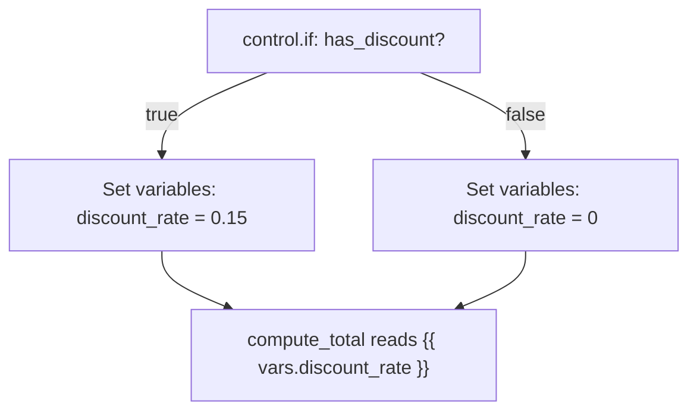
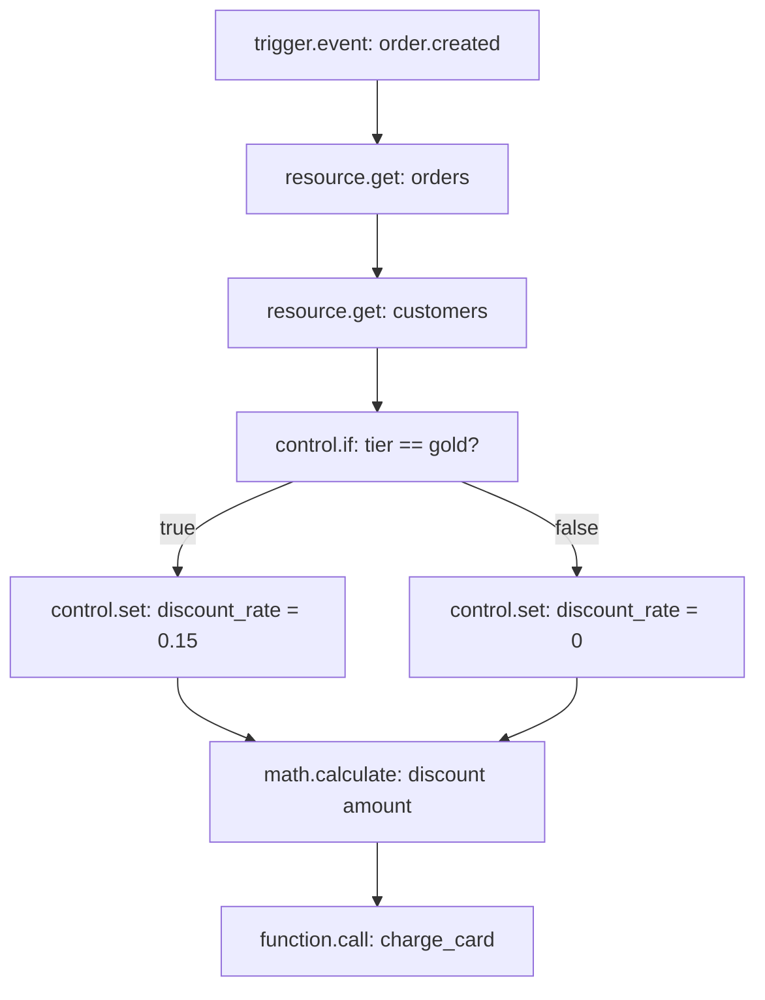

`vars` starts empty and stays in memory for exactly the lifetime of one run. It's the general-purpose place to put a value you've computed or chosen, so later Steps — including ones on a different branch than the one that computed it — can read it without needing to know which branch it came from.

You write to it with a **Set variables** Step:

```json
{ "id": "set_discount",
  "data": { "block": "control.set",
            "config": { "values": { "discount_rate": "{{ steps.check_tier.output.rate }}" } } } }
```

The field is `values` — an object mapping each variable name to the value (or template) it should hold. Every key you put in `values` is merged into `vars`, so a second Set variables Step later in the run can add more variables without clobbering the ones already set.

```json
{ "id": "set_shipping",
  "data": { "block": "control.set",
            "config": { "values": { "shipping_method": "standard" } } } }
```

After both Steps above have run, `vars` holds both `discount_rate` and `shipping_method` — later Steps read either with `{{ vars.discount_rate }}` and `{{ vars.shipping_method }}`.

<Tip>
A couple of other blocks also write into `vars`: **Read secret** stores the secret's value under the name you give it (or the secret's own name, if you don't), so it can be used in later templates without appearing anywhere in the trace.
</Tip>

`vars` merging both branches of a condition into the same variable is the standard way to make a downstream Step branch-agnostic:



Whichever branch ran, `compute_total` reads the same path and doesn't need an If of its own to know which branch fired.

<Warning>
`vars` is not a database. It exists only for the duration of a single run and isn't shared between concurrent runs of the same Flow. If a value needs to survive past this run, write it with **Update record** or **Cache set** instead.
</Warning>


## `steps` — every finished Step's output

Every time a Step finishes — successfully or by taking an error branch — its result is recorded under `steps.<step id>`:

```json
{
  "steps": {
    "load_order": { "output": { "id": "ord_1", "status": "paid", "total": 49.99 }, "handle": "next" },
    "get_customer": { "output": { "id": "cus_1", "email": "a@example.com", "tier": "gold" }, "handle": "next" }
  }
}
```

Each entry has two fields: `output` (whatever the block returned) and `handle` (which output the block took — `next`, `missing`, `true`, and so on). Any later Step reads an earlier one's output with a template:

```json
{ "id": "confirm_email",
  "data": { "block": "mail.send",
            "config": {
              "to": "{{ steps.get_customer.output.email }}",
              "subject": "Order {{ steps.load_order.output.id }} confirmed"
            } } }
```

<Tip>
`steps.<id>.output` is the block's **raw** return value — never wrapped in an extra layer. If Get record returns `{ "id": "cus_1", "email": "..." }`, you read the email as `{{ steps.get_customer.output.email }}`, not `{{ steps.get_customer.output.data.email }}`.
</Tip>

Because a Step's ID is exactly the node ID shown on its block in the canvas, renaming a node's ID in the inspector changes what path later Steps need to use to reach it — the inspector rewrites edges automatically when you rename a node, but it does **not** rewrite `{{ steps.<old id>... }}` references inside other nodes' configuration. Recheck downstream Steps after a rename.

### You can only read a Step that ran before you, on the path that led to you

`steps` only ever contains Steps that have actually finished by the time the current Step runs — not every Step that exists somewhere in the graph. Two consequences:

- A Step later in the same path can read an earlier one's output. A Step earlier in the path can never read a later one's output — there's nothing there yet, and the lookup comes up empty rather than erroring.
- If two branches both lead somewhere and only one of them actually ran (an If took `false`), the Step that never ran never appears in `steps` at all — not even as `null`. A template reading `{{ steps.that_step.output }}` after a branch that skipped it gets the same empty result as a typo would.


## `item` and `index` — inside a loop body

Inside a **For each** Step's body, two extra values are available for the duration of that one iteration: `item` (the current element) and `index` (its position, starting at `0`):

```json
{ "id": "loop", "data": { "block": "control.foreach", "config": { "items": "{{ input.body.line_items }}" } } }
```

A Step inside that loop's body reads the current element directly:

```json
{ "id": "add_item",
  "data": { "block": "resource.create",
            "config": { "resource": "order_lines",
                        "data": { "sku": "{{ item.sku }}", "qty": "{{ item.quantity }}", "position": "{{ index }}" } } } }
```

`item` and `index` exist only inside that one iteration of that one loop's body. Once the loop finishes (or the body Step finishes, for a single iteration), they're gone — a Step after the loop can't read them, and a Step inside a *different* loop sees only its own loop's current `item`/`index`, never a value left over from a previous loop.

<Tip>
A `for each`'s own output — `{{ steps.loop.output }}` — is the list of every iteration's last Step output, in order. That's how you carry a loop's results forward without reading `item`/`index` outside the loop.
</Tip>


## `error` — populated once an Error handle fires

Most Steps have an **Error** handle you can optionally connect. Nothing is added to state for a Step that fails *without* a connected Error handle — the run simply fails. But the moment a connected Error handle fires, the engine drops a small object into `error`:

```json
{ "error": { "message": "Order not found", "type": "FlowError", "node": "load_order" } }
```

From inside that error branch, a template can reference `{{ error.message }}`, `{{ error.type }}`, and `{{ error.node }}`:

```json
{ "id": "log_failure",
  "data": { "block": "log.write",
            "config": { "level": "warning", "message": "{{ error.node }} failed: {{ error.message }}" } } }
```

<Warning>
Unlike `input`, `auth`, and `vars`, `error` is **not** reset or cleared as the run continues past the branch that handled it. If a second, unrelated Step fails later in the same run and takes its own Error handle, `error` is simply overwritten with that failure's details. And if no later failure overwrites it, a Step that runs much further downstream — one that never had anything to do with the original failure — could still technically read a stale `{{ error.message }}` left over from earlier in the run. In practice this only matters if you reference `error` outside the error branch that's meant to handle it; keep `error` reads confined to the branch immediately following the failing Step, and it behaves exactly as expected.
</Warning>

See [Errors and retries](/flows/errors-and-retries) for the full mechanics of which blocks have Error handles, how `control.retry` interacts with this, and how to design branches around failures.


## `project`, `env`, and `run`

Three more namespaces are set once, at the very start of the run, and don't change:

| Path | Holds |
| --- | --- |
| `project` | The project's reference this run belongs to |
| `env` | Which environment ran it — `development`, `production`, or another environment name |
| `run.id` | This run's own unique ID |
| `run.flow` | The Flow's name |

These are mostly useful for logging — a **Log** Step's entries already include the run ID and Flow name automatically, but you can also pull `{{ run.id }}` into a Step's own configuration (tagging an outbound webhook payload with the originating run, for instance).


## A worked example: order fulfillment

Here's how state fills in as a realistic multi-step Flow runs — an order-fulfillment Flow triggered by an `order.created` event.

```json
{
  "nodes": [
    { "id": "t", "data": { "block": "trigger.event", "config": { "event": "order.created" } } },
    { "id": "load_order", "data": { "block": "resource.get",
        "config": { "resource": "orders", "id": "{{ input.event.payload.order_id }}" } } },
    { "id": "get_customer", "data": { "block": "resource.get",
        "config": { "resource": "customers", "id": "{{ steps.load_order.output.customer_id }}" } } },
    { "id": "check_tier", "data": { "block": "control.if",
        "config": { "condition": { "eq": ["$steps.get_customer.output.tier", "gold"] } } } },
    { "id": "gold_discount", "data": { "block": "control.set",
        "config": { "values": { "discount_rate": 0.15 } } } },
    { "id": "no_discount", "data": { "block": "control.set",
        "config": { "values": { "discount_rate": 0 } } } },
    { "id": "compute_discount", "data": { "block": "math.calculate",
        "config": { "operation": "multiply",
                    "values": ["{{ steps.load_order.output.subtotal }}",
                               "{{ vars.discount_rate }}"] } } },
    { "id": "charge", "data": { "block": "function.call",
        "config": { "function": "charge_card",
                    "input": { "customer_id": "{{ steps.get_customer.output.id }}",
                               "amount": "{{ steps.load_order.output.subtotal }}",
                               "discount": "{{ steps.compute_discount.output }}" } } } }
  ],
  "edges": [
    { "source": "t", "target": "load_order" },
    { "source": "load_order", "target": "get_customer" },
    { "source": "get_customer", "target": "check_tier" },
    { "source": "check_tier", "target": "gold_discount", "sourceHandle": "true" },
    { "source": "check_tier", "target": "no_discount", "sourceHandle": "false" },
    { "source": "gold_discount", "target": "compute_discount" },
    { "source": "no_discount", "target": "compute_discount" },
    { "source": "compute_discount", "target": "charge" }
  ]
}
```



Walking through what `state` holds by the time `charge` runs:

```json
{
  "input": { "event": { "name": "order.created", "payload": { "order_id": "ord_1" }, "id": "evt_1a2b", "occurred_at": "2026-09-30T14:02:11Z" } },
  "auth": {},
  "vars": { "discount_rate": 0.15 },
  "steps": {
    "t": { "output": { "event": "order.created" }, "handle": "next" },
    "load_order": { "output": { "id": "ord_1", "customer_id": "cus_1", "subtotal": 49.99 }, "handle": "next" },
    "get_customer": { "output": { "id": "cus_1", "tier": "gold" }, "handle": "next" },
    "check_tier": { "output": true, "handle": "true" },
    "gold_discount": { "output": { "discount_rate": 0.15 }, "handle": "next" },
    "compute_discount": { "output": 7.4985, "handle": "next" }
  },
  "project": "acme",
  "env": "production",
  "run": { "id": "9f2c1e...", "flow": "fulfill_order" }
}
```

Notice `no_discount` never appears in `steps` at all — the `false` branch didn't run for this particular order, so there's simply nothing recorded for that node. If a later Step mistakenly referenced `{{ steps.no_discount.output }}`, it would get an empty result rather than an error, for exactly that reason.
