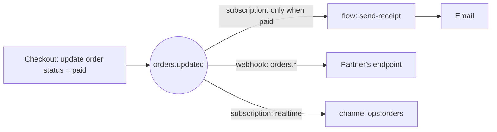

You'll wire one business moment, **an order is paid**, to three independent reactions:

1. Email the customer a receipt.
2. Tell your fulfilment partner, with a signed webhook.
3. Update a live "orders today" dashboard.

The code that marks the order paid knows about none of them. Adding a fourth reaction later is configuration, not a deploy.

**You'll use:** [events](/automation/events), [flows](/logic/flows), [mail](/mail/overview), [outbound webhooks](/automation/webhooks), [realtime](/realtime/overview).

## How it works



When the order is updated through the API, the `orders` table emits `orders.updated` with the record. Each reaction is a separate background job, so they run independently: if the partner is down, the receipt still goes out.

## 1. The table and the moment

You need an `orders` table with `status`, `total`, `customer_id` and **Emit events** on (it's on by default, under **Settings**). Your checkout marks it paid:

<CodeGroup>
```typescript TypeScript
await pawabase.from("orders").update(orderId, { status: "paid" });
```

```python Python
pb.from_("orders").update(order_id, status="paid")
```
</CodeGroup>

## 2. Reaction one: the receipt

**Template.** In **Mail → Templates**, create `receipt` from the *Payment receipt* design, with values `customer.first_name`, `order.id` and `order.total`, and **publish** it.

**Flow.** In **Flows → New flow**, `send-receipt`:

1. A **Get record** block, node id `customer`, table `customers`, id `{{ input.event.payload.record.customer_id }}`. Connect `missing` to a **Log** block.
2. An **If** block: `{{ steps.customer.output.receipt_opt_out }}` is not true (skip people who opted out).
3. **Send email**: **To** `{{ steps.customer.output.email }}`, **Template** `receipt`, **Data**:

```json
{ "customer": { "first_name": "{{ steps.customer.output.first_name }}" }, "order": "{{ input.event.payload.record }}" }
```

**Subscription.** In **Event subscriptions → New**: event `orders.updated`, **Only when** `$event.payload.record.status` **equals** `paid`, **Then** the flow `send-receipt`.

<Note>
An update that doesn't change the status (say, editing the address of a paid order) also emits `orders.updated` with `status: "paid"`, and would send a second receipt. Make the flow safe to repeat: give `orders` a `receipt_sent_at` field, have the flow stop if it's set, and set it with **Update record** after sending. See [Reliability](/automation/reliability#design-rule-1-make-reactions-safe-to-repeat).
</Note>

## 3. Reaction two: the partner webhook

In **Webhooks → Endpoints → New webhook**:

| Field | Value |
| --- | --- |
| Name | `fulfilment` |
| Endpoint URL | The partner's `https://` address |
| Events | `orders.updated` |
| Attempts | `8` |

Copy the generated **signing secret** to the partner. They verify each request ([Verify signatures](/automation/webhook-signatures)) and deduplicate on the event `id`.

A webhook receives **every** `orders.updated`, not just paid ones; webhooks have no condition. If the partner should only hear about paid orders, send a smaller event of your own instead: in `send-receipt` (or a separate flow), add **Send webhook** with event `order.paid` and the fields the partner needs, and subscribe the endpoint to `order.paid`. That also keeps the rest of the record private.

Press **Send test** on the endpoint to check the partner's receiver answers.

## 4. Reaction three: a live dashboard

In **Event subscriptions → New**: event `orders.updated`, **Only when** status equals `paid`, **Then** *Realtime*, channel `ops:orders`.

Add a [channel rule](/realtime/channel-rules) for `ops:*` whose **Subscribe policy** is your staff role (for example **Users with role** `staff`), and **Publish policy** *Nobody* (only Pawabase publishes there).

```typescript src/dashboard.ts
const feed = pawabase.realtime.channel("ops:orders");
feed.onEvent("orders.updated", (m) => addToToday(m.payload.record));
await feed.subscribe();
```

## 5. Watch it work

Mark a test order paid, then open **Activity → Events** and find the `orders.updated` event. It lists every consumer it reached: the `send-receipt` flow, the realtime channel and the `fulfilment` webhook, and how each went. From there:

- **Flow runs** shows the receipt flow's trace.
- **Mail activity** shows the email and what the server answered.
- **Webhooks → Deliveries** shows the partner's response.

## 6. When something fails

| Failure | What happens | What you do |
| --- | --- | --- |
| Email provider down | The email is retried 3 times, then marked failed | Fix it, then **Retry** in [Mail activity](/mail/activity) |
| Partner down | The delivery retries for up to 8 attempts over hours | Once they're back, it delivers; or **Redeliver** failures in bulk |
| The flow has a bug | The run fails once | Fix the flow, then **Retry** the job, or **Replay** many |

Set alarms on **Failed jobs**, **Mail failed** and **Failed webhook deliveries** so you hear about it. See [Logs, metrics and alarms](/activity/alarms).

## Adding a fourth reaction

Loyalty points? Add a subscription on `orders.updated` (paid) running an `award-points` flow. Nothing else changes.

<CardGroup cols={2}>
  <Card title="Events" icon="bolt" href="/automation/events">Everything about events.</Card>
  <Card title="Reliability" icon="shield-check" href="/automation/reliability">Design for failure.</Card>
</CardGroup>
