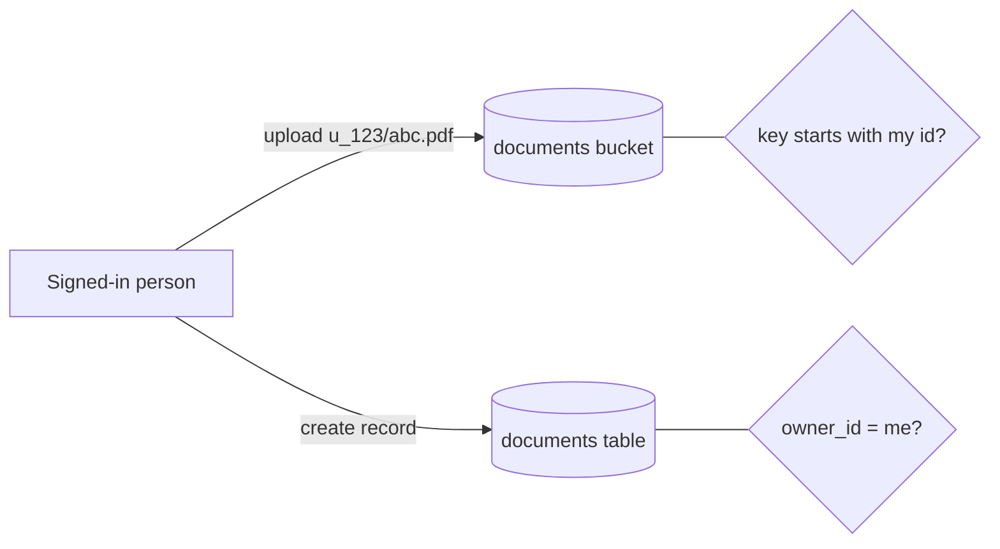

You'll build private document storage: each person uploads files into **their own folder**, only they can list, read, replace or delete them, a table keeps a record of each file with its title, and they can share one file with someone else through a link that expires.

**You'll use:** [Storage](/storage/overview), [rules on storage](/policies/storage), a [table](/database/overview) and the TypeScript client.

**Before you start:** have sign-in working, as in [An app with signed-in users](/guides/signed-in-app).

## How it works

File **keys** are paths. Put the owner's id first: `<user id>/<file id>.pdf`. Then one rule on the bucket, "the first part of the key is the caller's id", protects every action. A `documents` table records each upload, with its own owner rule, so you can list, search and title files like any other data.



## 1. Create the bucket

**Storage → New bucket**:

| Setting | Value | Why |
| --- | --- | --- |
| Name | `documents` | |
| **Public bucket** | off | Files are private |
| **Accepted types** | `application/pdf`, `image/*` | Checked against the file's real contents, not its name |
| **Largest file** | `20` MB | |

Signed download links are off for new buckets and have no switch in Studio. This guide uses them, so turn them on with `signed_downloads=True` in [infrastructure as code](/tools/iac/buckets) or the [management client](/tools/management-client).

## 2. Protect it with an owner-folder rule

Create a named rule in **Policies → New policy**, `own_folder`:

- **All of** these rules pass:
  - **Check a value:** `$auth.user_id` **is set**
  - **Compare values:** `$object.segments.0` **equals** `$auth.user_id`

```json
{ "name": "own_folder", "condition": { "all": [ { "truthy": "$auth.user_id" }, { "eq": ["$object.segments.0", "$auth.user_id"] } ] } }
```

In the bucket's **Access** section, use `own_folder` for **Who may read**, **Who may upload new objects**, **Who may list objects**, **Who may replace objects** and **Who may delete objects**.

`$object.segments.0` is the first part of the key, before the first `/`. A person whose id is `u_123` can reach `u_123/…` and nothing else.

## 3. Create the table

**Data → Tables → Create table** `documents`:

| Column | Type |
| --- | --- |
| `owner_id` | text, indexed (set as the table's **Owner field**) |
| `file_key` | text, **unique** |
| `title` | text, required |
| `content_type` | text |
| `size` | integer |

**Access**: every operation **Record owner (owner_id)**, and **Add records**: **Signed-in users**. This is exactly the setup from the [signed-in app guide](/guides/signed-in-app).

## 4. Upload and record the file

```typescript src/documents.ts
import { ApiError, PayloadTooLargeError, PermissionError } from "@pawabase/client";
import { pawabase } from "./pawabase";

const bucket = pawabase.storage.from("documents");

export async function uploadDocument(file: File, title: string) {
  const { user } = (await pawabase.auth.getSession())!;
  const key = `${user.id}/${crypto.randomUUID()}`;

  try {
    const stored = await bucket.upload(key, file, { contentType: file.type });
    return await pawabase.from("documents").create({
      file_key: stored.key,
      title,
      content_type: stored.content_type,
      size: stored.size,
    });
  } catch (e) {
    // The bucket refuses a wrong type or a file over its Largest file with a 400 whose message says which
    if (e instanceof ApiError && e.status === 400) throw new Error(e.message.includes("does not accept") ? "Only PDFs and images are accepted." : "That file is over 20 MB.");
    if (e instanceof PayloadTooLargeError) throw new Error("That file is over your plan's upload limit.");
    if (e instanceof PermissionError) throw new Error("You can only upload into your own folder.");
    throw e;
  }
}
```

- The key uses a **random id**, not the file's name: names collide, leak information and can contain characters you don't want in a path.
- Upload first, then create the record. If the record fails, the file is orphaned but harmless; a scheduled clean-up can remove files with no record ([Scheduled jobs](/guides/scheduled-jobs)).

### Large files: upload straight from the browser

For big files, ask for a **signed upload link** and send the file straight to storage, so it never passes through your own server:

```typescript
const signed = await bucket.createSignedUploadUrl(key, { expiresIn: 300, contentType: file.type, maxBytes: 20 * 1024 * 1024 });
await bucket.uploadToSignedUrl(signed.url, file, { contentType: file.type });
```

Creating the link checks the same **upload** rule, so a person can only get a link for their own folder. See [Upload](/storage/upload#upload-straight-from-the-browser).

## 5. List, show and download

```typescript
// the person's documents, newest first; the table's rule limits it to theirs
export const myDocuments = () => pawabase.from("documents").order("created_at", "desc");

// show or download one
export async function openDocument(doc: { file_key: string }) {
  const blob = await bucket.download(doc.file_key);
  return URL.createObjectURL(blob);
}
```

The download checks **Who may read** for the caller, so even if someone guessed another person's key, they'd get `404`.

## 6. Share a file with a temporary link

A **signed link** lets anyone who holds it read one file for a short time, with no sign-in:

```typescript
export async function shareLink(doc: { file_key: string }, minutes = 15) {
  const signed = await bucket.createSignedUrl(doc.file_key, { expiresIn: minutes * 60 });
  return signed.url;   // valid until signed.expires_at
}
```

Creating it checks that **the caller** may read the file, so people can only make links to their own documents. For longer-lived links with a label, a view or download choice and a way to revoke them, use [share links](/storage/share-links).

## 7. Delete

Delete the file and the record together:

```typescript
export async function deleteDocument(doc: { id: string; file_key: string }) {
  await bucket.remove(doc.file_key);
  await pawabase.from("documents").delete(doc.id);
}
```

## 8. Test the boundary

```typescript test/files.test.ts
import { createClient, NotFoundError } from "@pawabase/client";

const client = () => createClient({ url: process.env.PAWABASE_URL!, apiKey: process.env.PAWABASE_PUBLISHABLE_KEY!, environment: "development" });
const ada = client(); const bob = client();
await ada.auth.signInWithPassword({ email: "ada@example.com", password: process.env.PW! });
await bob.auth.signInWithPassword({ email: "bob@example.com", password: process.env.PW! });
const adaId = (await ada.auth.getUser()).id;

await ada.storage.from("documents").upload(`${adaId}/test.pdf`, new Blob(["%PDF-1.4"], { type: "application/pdf" }));

// Bob can't read, list or overwrite Ada's folder
await bob.storage.from("documents").download(`${adaId}/test.pdf`).then(() => { throw new Error("leak"); }, () => {});
await bob.storage.from("documents").list({ prefix: `${adaId}/` }).then(() => { throw new Error("leak"); }, () => {});
await bob.storage.from("documents").upload(`${adaId}/evil.pdf`, new Blob(["%PDF-1.4"])).then(() => { throw new Error("leak"); }, () => {});
```

## Variations

| You want | Change |
| --- | --- |
| Files shared within a company | Key `<org>/…` and the rule `$object.segments.0 equals $auth.org` (plus `$auth.org is set`). See [Teams and organizations](/guides/organizations). |
| Public profile pictures | A **public** bucket with `own_folder` only on upload, replace and delete. See [Avatars](/auth/user-profile). |
| Files your server creates, users download | Upload with a secret key; **Who may read** `own_folder` |
| Show thumbnails | Add `width` and `height` to the file's URL for an image. See [Images](/storage/images). |

## Troubleshooting

| Problem | Cause | Fix |
| --- | --- | --- |
| Uploads give `403` | The key doesn't start with the caller's id | Build keys as `${user.id}/…` |
| Uploads give `422` / unsupported type | The file's real type isn't in **Accepted types** | Check the file, or widen the accepted types |
| Uploads give `413` | Over **Largest file** | Raise the limit, or use a signed upload with `maxBytes` |
| Signed links don't work | `signed_downloads` is off for the bucket | Turn it on from code (IaC or the management client) |
| Listing shows nothing | Listing needs `prefix` set to the caller's folder | `list({ prefix: \`${user.id}/\` })` |

<CardGroup cols={2}>
  <Card title="Storage" icon="folder" href="/storage/overview">Everything buckets can do.</Card>
  <Card title="Rules on storage" icon="shield-check" href="/policies/storage">More file rules.</Card>
</CardGroup>
