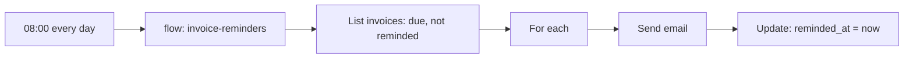

You'll build a classic background job: **every morning, remind customers about invoices that are due**, and make it robust: it never double-sends, a missed night just runs later, it's easy to test, and you hear about failures.

**You'll use:** [schedules](/automation/schedules), [flows](/logic/flows), [mail](/mail/overview), [alarms](/activity/alarms).

## The pattern: a sweep, not a timer per item

Don't create one delayed job per invoice. Run a short schedule that finds **whatever is due now**, handles it, and **marks** it. A missed run just means the next run finds a bit more; nothing is lost if a server restarts.



## 1. The table

`invoices` with: `customer_email`, `amount`, `due_at` (datetime), `status` (`open`, `paid`), and `reminded_at` (datetime, empty by default). Add an **index** on `(status, due_at)` so the sweep is fast as the table grows ([Indexes](/database/indexes)).

## 2. The template

**Mail → Templates**: `invoice-due` from the *Invoice* design, values `invoice.number`, `invoice.amount`, `invoice.due_at`, `pay_url`. Publish it.

## 3. The flow

**Flows → New flow** `invoice-reminders`, with a **Manual run** trigger (the schedule starts it):

1. **SQL query**, node id `due`: find what's due and not reminded. Using SQL lets you compare dates:

   ```sql
   SELECT id, number, customer_email, amount, due_at
   FROM invoices
   WHERE status = 'open' AND reminded_at IS NULL AND due_at <= $1
   ORDER BY due_at
   LIMIT 200
   ```

   with **params** `["{{ input.scheduled_at }}"]`.

2. **For each** over `{{ steps.due.output }}`. Inside its `each` branch, the current row is `item` (and its position `index`):
   - **Send email**: **To** `{{ item.customer_email }}`, **Template** `invoice-due`, **Data** `{"invoice": "{{ item }}", "pay_url": "https://app.example.com/pay/{{ item.id }}"}`.
   - **Update record**: table `invoices`, id `{{ item.id }}`, data `{"reminded_at": "{{ input.scheduled_at }}"}`.

3. A **Log** block after the loop's `done` exit: `Reminded {{ steps.due.output | length }} invoices`.

A **For each** handles items one at a time, at most 10,000 per run. See [Control flow](/logic/blocks/control#for-each).

<Note>
`LIMIT 200` keeps each run well inside the flow's time limit. If more are due, the next run picks them up. For bigger volumes, run more often (hourly) rather than raising the limit.
</Note>

## 4. The schedule

**Schedules → New schedule**:

| Field | Value | Why |
| --- | --- | --- |
| Name | `invoice-reminders` | |
| Cron | `0 8 * * *` | Every day at 08:00 |
| Time zone | `Europe/London` (your customers' zone) | 08:00 local time, all year |
| Run | Flow `invoice-reminders` | |
| If the previous run is still going | **Skip** | Two sweeps at once could double-send |
| Catch up | **On** | A morning missed during downtime runs once when things are back |

The flow receives `{ "scheduled_at": "…" }`. Using `scheduled_at` instead of "now" means a late run still uses the time it was meant for.

## 5. Test it

1. Create two invoices in `development`: one due yesterday, one due next week.
2. On the schedule, press **Run now**.
3. **Activity → Flow runs**: open the run. The `due` step should have one row, the loop one iteration.
4. **Mail activity**: one `invoice-due` message.
5. **Run now** again: the `due` step is now empty, because `reminded_at` is set. That's the double-send protection working.

## 6. Make failures loud

- An [alarm](/activity/alarms) on **Failed flow runs** above 0 over 60 minutes, emailing your team.
- **Activity → Overview** flags *Schedule invoice-reminders failed on its last run*.

If a run fails half-way, the invoices already reminded have `reminded_at` set and the rest don't, so **re-running is safe**: press **Run now** after fixing the cause.

## Variations

| You want | Change |
| --- | --- |
| A second reminder after 7 days | Add `second_reminded_at`, and a second query for `due_at <= now - 7 days` |
| Weekly digest | Cron `0 8 * * 1`, query last week's activity per customer |
| Clean up orphaned files nightly | A sweep that lists storage objects without a record and deletes them, with **Skip** overlap |
| Run every 5 minutes | Interval `300` seconds instead of a cron (no time zone) |

<CardGroup cols={2}>
  <Card title="Schedules" icon="calendar-clock" href="/automation/schedules">Every schedule setting.</Card>
  <Card title="Background jobs" icon="list-checks" href="/automation/jobs">Retries and replay.</Card>
</CardGroup>
