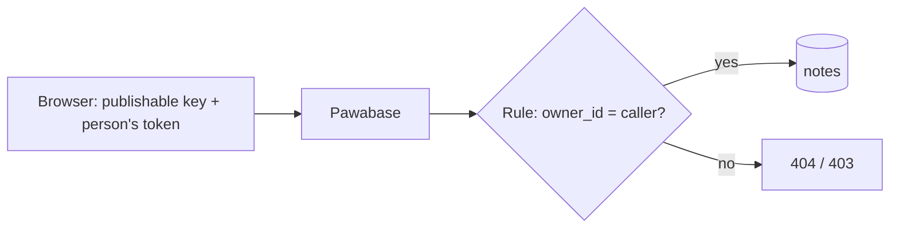

You'll build the core of almost every app: people create accounts, sign in, and work with **their own** data, and nobody can read or change anyone else's, even by editing your app's code in their browser.

**You'll use:** [Auth](/auth/overview), a [table](/database/overview), an [access rule](/policies/overview), and the TypeScript client (Python is shown for the server-side parts).

**Time:** about 20 minutes.

## How it works



Your app holds the **publishable key**, which is safe to ship. When someone signs in, the client also sends **their access token**. For every request, Pawabase evaluates the table's rule with that person's id, and for lists it turns the rule into a database filter, so only their rows are ever read.

## 1. Create the table

In Studio, open **Data → Tables → Create table**:

| Setting | Value |
| --- | --- |
| Name | `notes` |
| Columns | `title` (text, short, **required**), `body` (text, long), `owner_id` (text, **indexed**) |

Then open the table's **Settings** and set **Owner field** to `owner_id`. Pawabase will fill it with the signed-in person's id on every create, so your app never sends it.

## 2. Set the access rule

Open the table's **Access** tab and set each operation:

| Operation | Who passes |
| --- | --- |
| **See the list** | **Record owner (owner_id)** |
| **Open one record** | **Record owner (owner_id)** |
| **Add records** | **Signed-in users** |
| **Edit records** | **Record owner (owner_id)** |
| **Delete records** | **Record owner (owner_id)** |

"Record owner" means *the caller is signed in and `owner_id` equals their id*. Because the **edit** rule reads `owner_id`, nobody can change that field through your app either, so a note can't be handed to someone else. See [Write records](/database/write#fields-your-rule-depends-on-cant-be-changed).

<Note>
Prefer the rule picker's **Record owner** to a custom comparison: it becomes a database filter, so lists are exact and fast. See [How rules are evaluated](/policies/how-rules-are-evaluated).
</Note>

## 3. Turn on sign-up

Open **Users & auth → Sign-in & registration** and make sure **email and password** sign-in and **sign-up** are on. For a first test, you can leave email verification off; switch it on before launch ([Email verification](/auth/email-verification)). Also make sure [mail delivery](/mail/delivery) is set up if verification is on, or nobody can confirm their address.

Add your app's address (for example `http://localhost:5173`) under **Users & auth → Domains**, so confirmation links can return to it ([Redirect URLs](/auth/redirect-urls)).

## 4. Create the client

```typescript src/pawabase.ts
import { createClient } from "@pawabase/client";

export const pawabase = createClient({
  url: import.meta.env.VITE_PAWABASE_URL,
  apiKey: import.meta.env.VITE_PAWABASE_PUBLISHABLE_KEY, // pb_pk_… only, never a secret key
  environment: "development",
});
```

The browser build of the client refuses to start with a secret key, so you can't ship one by mistake.

## 5. Sign up and sign in

```typescript src/auth.ts
import { AuthenticationError, ValidationError, ConflictError } from "@pawabase/client";
import { pawabase } from "./pawabase";

export async function signUp(email: string, password: string, name: string) {
  try {
    const result = await pawabase.auth.signUp({ email, password, name, redirectTo: `${location.origin}/welcome` });
    if (result.verificationRequired) return "check-your-email"; // no session until they confirm
    return "signed-in";
  } catch (e) {
    if (e instanceof ConflictError) return "email-taken";
    if (e instanceof ValidationError) return e.message;          // e.g. password too short
    throw e;
  }
}

export async function signIn(email: string, password: string) {
  try {
    const result = await pawabase.auth.signInWithPassword({ email, password });
    if (result.status === "mfa_required") return result;          // ask for their code, then result.verify(code)
    return "signed-in";
  } catch (e) {
    if (e instanceof AuthenticationError) return "wrong-email-or-password";
    throw e;
  }
}

export const signOut = () => pawabase.auth.signOut();
```

`signInWithPassword` returns `{ status: "signed_in" }`, or `{ status: "mfa_required", verify }` when the person has two-step verification. See [Email and password](/auth/email-and-password).

## 6. Follow the session

The client stores the session, refreshes the token before it expires, and tells you when things change:

```typescript src/session.ts
import { pawabase } from "./pawabase";

pawabase.auth.onAuthStateChange((event, session) => {
  // INITIAL_SESSION, SIGNED_IN, SIGNED_OUT, TOKEN_REFRESHED, USER_UPDATED
  if (event === "SIGNED_OUT") showSignInScreen();
  else if (session) showApp(session.user);
});
```

Show your app's screens from this callback rather than checking once at startup: it also fires when the session ends in another tab or is revoked.

## 7. Read and write notes

```typescript src/notes.ts
import { NotFoundError } from "@pawabase/client";
import { pawabase } from "./pawabase";

export async function myNotes(page = 1) {
  // No filter needed: the rule already limits the list to the caller's notes.
  const { data, total } = await pawabase.from("notes").order("created_at", "desc").page(page).perPage(20);
  return { notes: data, total };
}

export function addNote(title: string, body = "") {
  return pawabase.from("notes").create({ title, body });   // owner_id is filled in for you
}

export function renameNote(id: string, title: string) {
  return pawabase.from("notes").update(id, { title });
}

export async function openNote(id: string) {
  try {
    return await pawabase.from("notes").get(id);
  } catch (e) {
    if (e instanceof NotFoundError) return null;  // missing, or someone else's: the API doesn't say which
    throw e;
  }
}

export const deleteNote = (id: string) => pawabase.from("notes").delete(id);
```

Notice what's **not** in this code: no `eq("owner_id", me)`. The rule does it on the server. Adding the filter in the client is harmless, but it isn't what protects the data.

## 8. Check it with two people

The test that matters is that one person can't see another's notes. Run this with a development publishable key:

```typescript test/isolation.test.ts
import { createClient, NotFoundError } from "@pawabase/client";

const make = () => createClient({ url: process.env.PAWABASE_URL!, apiKey: process.env.PAWABASE_PUBLISHABLE_KEY!, environment: "development" });

const ada = make();
const bob = make();
await ada.auth.signInWithPassword({ email: "ada@example.com", password: process.env.ADA_PASSWORD! });
await bob.auth.signInWithPassword({ email: "bob@example.com", password: process.env.BOB_PASSWORD! });

const note = await ada.from("notes").create({ title: "Ada's secret" });

const bobsList = await bob.from("notes");
console.assert(!bobsList.data.some((n) => n.id === note.id), "Bob must not see Ada's note");

await bob.from("notes").get(note.id).then(
  () => { throw new Error("Bob must not open Ada's note"); },
  (e) => console.assert(e instanceof NotFoundError),
);

const anonymous = make();
console.assert((await anonymous.from("notes")).data.length === 0, "Signed-out callers see nothing");
```

Run tests like this against `development` in CI whenever rules change. More techniques are in [Testing rules](/policies/testing).

## 9. From a server

On your own server, act **for** a signed-in person by passing their access token, so the same rules apply:

<CodeGroup>
```typescript TypeScript
import { createClient } from "@pawabase/client";

// one client per request, with the person's token from your app's request
const forUser = createClient({ url, apiKey: process.env.PAWABASE_PUBLISHABLE_KEY!, environment: "production" });
await forUser.auth.setSession({ access_token, refresh_token });
const notes = await forUser.from("notes");
```

```python Python
from pawabase import Pawabase

pb = Pawabase(url, PUBLISHABLE_KEY, environment="production")
pb.auth.set_session(access_token=access_token, refresh_token=refresh_token)
notes = pb.from_("notes").execute().data
```
</CodeGroup>

Use a **secret key** only for work that should ignore the rules, like an admin export, and never on behalf of an individual request. See [Node.js](/quickstarts/node).

## Troubleshooting

| Problem | Cause | Fix |
| --- | --- | --- |
| Creating a note gives `401` | Not signed in | Check the session before writing; listen to `onAuthStateChange` |
| Creating gives `403` | **Add records** isn't *Signed-in users*, or it's off | Check the table's Access tab |
| The list is empty after creating | `owner_id` isn't set as the **Owner field**, so it's empty and the rule fails | Set **Owner field** in Settings |
| `signUp` gives no session | Email verification is on | Show "check your email"; the link signs them in |
| The confirmation link fails | Your app's address isn't an allowed redirect | Add it under **Users & auth → Domains** |
| Changing `owner_id` gives `403` | Intended: the edit rule reads it | Change ownership from a server with a secret key |

## Where next

<CardGroup cols={2}>
  <Card title="Teams and organizations" icon="building" href="/guides/organizations">Share data inside a company.</Card>
  <Card title="Private files" icon="lock" href="/guides/private-files">Let people upload their own files.</Card>
  <Card title="Passkeys" icon="fingerprint" href="/auth/passkeys">Passwordless sign-in.</Card>
  <Card title="Access rules" icon="shield-check" href="/policies/overview">Everything rules can do.</Card>
</CardGroup>
