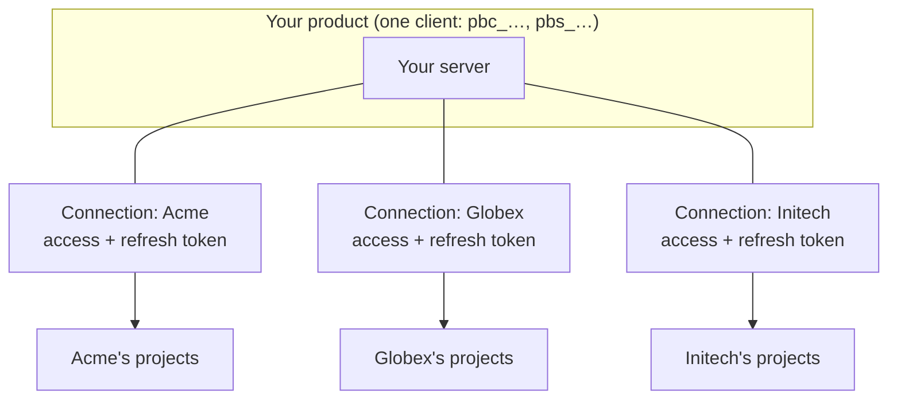

Three words come up in every integration, and they mean three different things. Most mistakes (a secret in a browser, a token shared between customers, a connection that ends by surprise) come from mixing them up.

| Word | What it is | Lives | Lasts |
| --- | --- | --- | --- |
| **App** (or **client**) | Your product's identity at Pawabase: a name, a logo, callback addresses, and a **client id** and **client secret** | Settings → Integrations → Your apps | Until you delete it |
| **Connection** | One organization's approval of your app, for the scopes it was shown | Settings → Integrations → Connected apps | Until someone disconnects it, or it goes 30 days unused |
| **Token** | The short-lived proof of one connection that your server sends with a call | Your server's database | An access token: 1 hour. A refresh token: 30 days, replaced on every use |

## The client

An OAuth **client** is how Pawabase recognises *your product* when it calls `/oauth/*`. You register it once, in the organization that owns your product, and Pawabase gives you two strings:

- the **client id**, `pbc_…`. Public. It appears in the address people are sent to, so anyone can see it.
- the **client secret**, `pbs_…`. Private. It proves a request to `/oauth/token` really comes from your server. Pawabase shows it once and keeps only a hash.

A client is **not** a person, and it is **not** one customer's access. One client serves every customer: each customer who connects gets their own connection and their own tokens, all under your one client id.



### Confidential and public clients

| | Confidential | Public |
| --- | --- | --- |
| **Is** | A web app or backend that can keep a secret | A desktop app, a CLI or a mobile app, where anything you ship can be read |
| **Proves itself with** | The client secret, and PKCE | PKCE alone (no secret at all) |
| **Rule** | The secret stays on your server. Never in a browser or an app bundle | A callback address on `127.0.0.1` (any port), with PKCE on every sign-in |

Always use PKCE (the client libraries do). With it, a stolen authorization code is useless: it can only be traded by whoever holds the one-time verifier that your server made for that sign-in.

### OAuth app or platform app

The **type** is chosen when you register and can't change.

- An **OAuth app** acts for people who approve it. It is what an IDE or an AI builder registers.
- A **platform app** can also act on its own organization with no person involved (`client_credentials`), to make projects for its own users and hand them over. See [Platform apps and claim links](/integrations/platform-apps).

## The connection

A connection is the record that says: *this person approved this app for this organization, for these scopes.* It is created when a person clicks **Connect** on the consent screen.

- It is for **one organization**. A person in three organizations who wants all three connected goes through the flow three times.
- It keeps the person who approved it. Everything the app does is done *as that person*: Pawabase works out each call's power from the scopes **and** the person's current role. If they are demoted or leave, the connection's power shrinks with them.
- It shows in the organization's **Connected apps** list, where an admin can disconnect it.
- Connecting again for an organization that is already connected updates the connection instead of making a second one.

## The tokens

Each connection holds two tokens:

| Token | Looks like | Sent to | Lasts |
| --- | --- | --- | --- |
| **Access token** | A long signed string | The Management API, as `Authorization: Bearer …` | 1 hour |
| **Refresh token** | `pbr_…` | `/oauth/token`, to get a new pair | 30 days. **Single use**: every refresh returns a new one |

Keep both on your server, next to your own user record and the organization slug. Treat them like passwords. A refresh token used twice ends the whole connection, because only a copy could be used twice; see [refreshing safely](/integrations/oauth-flow#reuse-detection).

There are two more kinds of token, for the other ways in: the platform app's own `client_credentials` token (no refresh token, ask again when it expires), and the [personal access token](/integrations/personal-tokens), `pbp_…`, that you make yourself in the dashboard.

## In code

At the HTTP level there is nothing to construct: the client is the two strings, and a connection is the tokens you saved.

```bash
# Your client: the id is public (it goes in the authorize address), the secret stays on your server.
curl -s https://dashboard.pawabase.com/oauth/token -u "$CLIENT_ID:$CLIENT_SECRET" -d grant_type=refresh_token -d refresh_token="$SAVED_REFRESH_TOKEN"

# One connection: the access token you saved for that customer's organization.
curl -s https://dashboard.pawabase.com/v1/projects -H "Authorization: Bearer $SAVED_ACCESS_TOKEN"
```

The [client libraries](/integrations/sdk) are an optional wrapper that gives each side an object: `PawabaseOAuth` (`OAuth` in Python) for your client, made once at startup, and `PawabaseCloud` (`Cloud`) for one connection, made per customer from their tokens. They send the same requests as above.

Next: [register an app](/integrations/register-an-app) to get your client id and secret, then [the OAuth flow](/integrations/oauth-flow).
