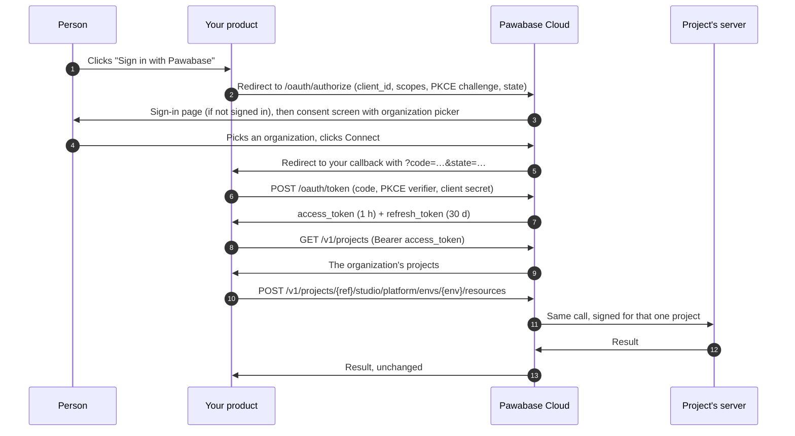

**Integrations** let another product work with a Pawabase organization on behalf of the people who use it. An IDE, an AI app builder, a hosting platform, a CI service or your own internal tool can put a **Sign in with Pawabase** button in its interface. The person signs in with their Pawabase account, picks one of their organizations, approves what the product asks for, and the product can then create projects, read and change what is inside them, and deploy marketplace apps — within the limits the person approved and the role they hold.

This is the same model other developer platforms use for their "connect" integrations: a standard OAuth 2.0 authorization server, a consent screen with an organization picker, short-lived access tokens, rotating refresh tokens, and one HTTP API that takes those tokens.

All of it lives in Pawabase Cloud, at `https://dashboard.pawabase.com`.

<Note>
Integrations need Pawabase Cloud **v0.26.0** or later. A self-hosted Cloud on an older release doesn't have these routes; check with `make version` on its server. File downloads through the project API (such as `blueprint.zip`) also need the project servers on Pawabase **v0.23.0** or later.
</Note>

## Start with the SDK

You can call every endpoint by hand, but the [integration SDK](/integrations/sdk) does the OAuth plumbing (PKCE, state, token refresh) and wraps the Management API. Two classes: `PawabaseOAuth` is your registered app, and `PawabaseCloud` is one customer's connection.

<CodeGroup>
```typescript TypeScript
import { PawabaseOAuth, PawabaseCloud } from "@pawabase/client/cloud";

const oauth = new PawabaseOAuth({ clientId, clientSecret, redirectUri });
const { url, state, codeVerifier } = await oauth.authorize({ scopes: ["projects:read", "projects:write"] }); // send the person to `url`
const tokens = await oauth.callback(returnedUrl, { state, codeVerifier });                                      // they come back
const pawabase = new PawabaseCloud({ token: oauth.tokenSource(tokens, { onRefresh: save }) });
const projects = await pawabase.projects.list();
```

```python Python
from pawabase.cloud import OAuth, Cloud

oauth = OAuth(client_id=..., client_secret=..., redirect_uri=...)
pending = oauth.authorize(scopes=["projects:read", "projects:write"])  # send the person to pending.url
tokens = oauth.callback(returned_url, state=pending.state, code_verifier=pending.code_verifier)  # they come back
pawabase = Cloud(token=oauth.token_source(tokens, on_refresh=save))
projects = pawabase.projects.list()
```
</CodeGroup>

New to the words? [Apps, clients and connections](/integrations/clients) explains what a client id, a connection and a token are, and which belongs to whom.

## Three ways in

| | OAuth app | Platform app | Personal access token |
| --- | --- | --- | --- |
| **For** | Products used by many Pawabase customers | Products that make Pawabase projects for their own users | Your own scripts, CI jobs and the CLI |
| **Who approves** | Each person, on the consent screen, for one of their organizations | Nobody: the app acts on the organization that registered it | You, when you create the token |
| **Acts as** | The person who approved, with their role, limited by the scopes | An admin of the app's own organization, limited by the scopes | You, with your role, limited by the scopes you picked |
| **Token** | Access token (1 hour) + refresh token (30 days, rotates) | Access token (1 hour) from `client_credentials`; ask again when it runs out | `pbp_…`, lasts until it expires or you revoke it |
| **Set up in** | **Settings → Integrations → Register app** | Same, with **Platform app** chosen | **Settings → Integrations → New token** |
| **Read** | [Register an app](/integrations/register-an-app), [OAuth flow](/integrations/oauth-flow) | [Platform apps and claim links](/integrations/platform-apps) | [Personal access tokens](/integrations/personal-tokens) |

All three call the same [Management API](/integrations/management-api) with `Authorization: Bearer <token>`, and all three are limited by the same five [scopes](/integrations/scopes-and-roles).

## What a connected product can do

Everything happens through the Management API under `https://dashboard.pawabase.com/v1`:

- **The organization**: its name, plan and how many projects it has.
- **Projects**: list, create, rename, pause, restore and delete them; read where each project's API answers and the name of its first environment.
- **Marketplace apps**: list Pawabase's ready-made apps and deploy one, either into a new project or into an empty one.
- **API keys**: list a project's keys and create new publishable or secret keys for the product's own use.
- **Everything inside a project**: `/v1/projects/{ref}/studio/{path}` reaches the same API Studio uses. Tables, records, access rules, flows, routes, sign-in settings and users, mail templates, buckets and files, secrets, webhooks, schedules, blueprints, logs — anything a person can do in Studio, the product can do through this path, confined to that one project.

See [Inside a project](/integrations/project-api) for the last one in detail.

## How the pieces fit



Three things in that diagram matter:

1. **The product never sees the person's Pawabase password.** Signing in happens on `dashboard.pawabase.com`. The product only receives a one-time code, and only after the person clicks **Connect**.
2. **The organization is the person's choice.** A product is connected to one organization at a time. If a person belongs to several, they pick one on the consent screen; to connect another, they go through the flow again and pick the other one.
3. **Cloud stands between the product and the project.** Calls inside a project go to Cloud first. Cloud checks the token, the scope and the person's role, then signs a short-lived request for that one project and forwards it. The product never holds a credential that reaches a project directly, unless it creates an [API key](/integrations/management-api#api-keys) for itself.

## The consent screen

When a product sends someone to `/oauth/authorize`, Pawabase shows one card:

- the product's logo (or initial) and the Pawabase mark, joined by a line,
- "**\{Product\}** wants to connect to Pawabase", with who registered the product and its website,
- the list of what it will be able to do, one line per scope,
- an **Organization** picker listing only the organizations where the person's role is high enough for those scopes,
- **Cancel** and **Connect**,
- the host the browser will return to.

If the person is signed out, Pawabase shows its sign-in page first (email and password, Google, GitHub, or whatever the account uses, including two-step verification) and returns to the consent screen afterwards. Nothing about the product's request is lost on the way.

**Cancel** sends the browser back to the product with `error=access_denied`. **Connect** sends it back with a code.

## Safety model

<CardGroup cols={2}>
  <Card title="Scopes and roles together" icon="shield-check">
    A token can do what its scopes allow **and** what the person's current role allows. A person who is demoted or leaves the organization takes the product's power with them, at once.
  </Card>
  <Card title="Short-lived access" icon="clock">
    Access tokens last an hour. Refresh tokens rotate on every use; a refresh token used twice ends the whole connection, because only a copy could be used twice.
  </Card>
  <Card title="Nothing stored in clear" icon="lock">
    Client secrets, refresh tokens, personal tokens and authorization codes are stored only as SHA-256 hashes. A database leak does not leak working credentials.
  </Card>
  <Card title="Visible and revocable" icon="eye">
    Every connected product is listed in **Settings → Integrations → Connected apps**, with who connected it, what it can do and when it was last used. An admin disconnects it with one click.
  </Card>
</CardGroup>

The full rules — which role each scope needs at consent, how a token's power is worked out on each request, and which project paths are refused — are in [Scopes and roles](/integrations/scopes-and-roles) and [Security](/integrations/security).

## Addresses

| Address | What it is |
| --- | --- |
| `https://dashboard.pawabase.com/oauth/authorize` | Where you send the person's browser |
| `https://dashboard.pawabase.com/oauth/token` | Where your server trades codes and refresh tokens |
| `https://dashboard.pawabase.com/oauth/revoke` | Where your server ends a connection |
| `https://dashboard.pawabase.com/.well-known/oauth-authorization-server` | The server's metadata (RFC 8414), for OAuth libraries that discover endpoints |
| `https://dashboard.pawabase.com/v1/…` | The Management API |
| `https://dashboard.pawabase.com/connect` | The consent screen (you never link here directly; `/oauth/authorize` sends people there) |
| `https://dashboard.pawabase.com/claim?token=…` | The page a platform app's claim link opens |

A self-hosted Pawabase Cloud uses its own address in place of `dashboard.pawabase.com`: whatever its `APP_URL` is set to. The metadata document always reports the right addresses for the server you are talking to.

## Where to go next

<CardGroup cols={2}>
  <Card title="Apps, clients and connections" icon="id-card" href="/integrations/clients">What a client is, and how it differs from a connection and a token.</Card>
  <Card title="The integration SDK" icon="package" href="/integrations/sdk">TypeScript and Python: OAuth, token refresh and the Management API.</Card>
  <Card title="Register an app" icon="badge-check" href="/integrations/register-an-app">Get a client id and secret, set callback URLs, choose OAuth or platform.</Card>
  <Card title="The OAuth flow" icon="arrow-left-right" href="/integrations/oauth-flow">Every parameter of authorize, token, refresh and revoke, with code.</Card>
  <Card title="Scopes and roles" icon="shield-check" href="/integrations/scopes-and-roles">What each scope allows and which role it needs.</Card>
  <Card title="Management API" icon="server" href="/integrations/management-api">Every /v1 endpoint, request and response.</Card>
  <Card title="Inside a project" icon="database" href="/integrations/project-api">Tables, flows, users, files and more through the Studio API.</Card>
  <Card title="Platform apps" icon="building" href="/integrations/platform-apps">Make projects for your users and hand them over with claim links.</Card>
  <Card title="Personal access tokens" icon="key" href="/integrations/personal-tokens">Tokens for your scripts, CI and the CLI.</Card>
  <Card title="Example: Connect a product" icon="code" href="/integrations/example-app">A small web app built on the SDK, in Express and Flask.</Card>
  <Card title="Connected apps" icon="plug" href="/integrations/connected-apps">For organization admins: see and disconnect products.</Card>
  <Card title="Security" icon="lock" href="/integrations/security">Threats, protections and what you must do on your side.</Card>
  <Card title="Errors and troubleshooting" icon="triangle-alert" href="/integrations/errors">Every error code, and the mistakes integrators make most.</Card>
</CardGroup>
