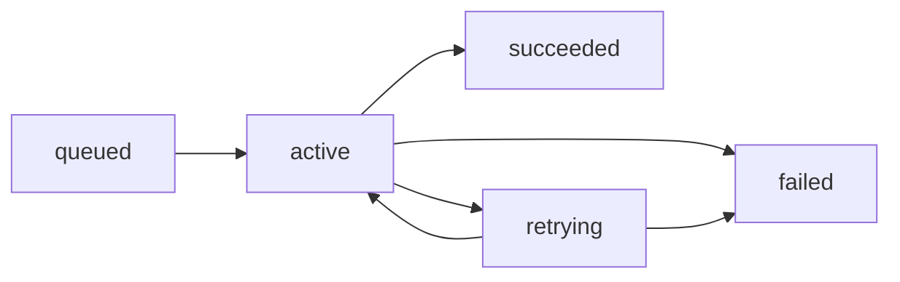
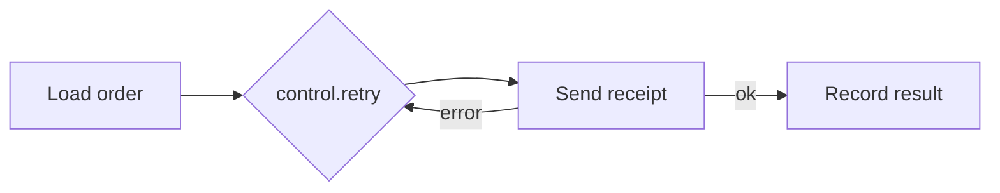

## States

Every job moves through these states:



| Status | Meaning |
| --- | --- |
| `queued` | Waiting for its turn on a queue, or waiting out a `delay` |
| `active` | Running now |
| `retrying` | An attempt failed and another is scheduled |
| `succeeded` | Finished without an error |
| `failed` | Gave up. No attempts remain |

Filter on these when you list jobs: `m.jobs.list({ status: "failed" })`. See [monitoring](/jobs/monitoring).

## One attempt by default

A job is tried **once**. If it fails, it moves straight to `failed`.

This is intentional. Automatic retries are safe only when the work can run twice without harm. Sending a receipt twice is an annoyance; charging a card twice is an incident. Pawabase cannot tell which kind of work you wrote, so it does not guess.

You can read the retry settings in effect for each kind of work:

<CodeGroup>
```typescript TypeScript
const policies = await m.jobs.retryPolicies();
```

```python Python
policies = pb.manage.jobs.retry_policies()
```
</CodeGroup>

The result lists, for each kind of background work, how many attempts it gets and how long it waits before each retry.

## Retrying on purpose inside a flow

For flows, add a `control.retry` block around the step that can fail for a passing reason, such as a network error:

```json
{
  "id": "retry_send",
  "data": {
    "block": "control.retry",
    "config": { "attempts": 3, "base_delay": 2 }
  }
}
```

`attempts` is the total number of tries and `base_delay` is the first wait in seconds, growing on each retry. Only the wrapped step repeats, not the whole flow, so work before it is not done twice.



Wrap the narrowest step you can. Putting the retry around a step that already succeeded once re-runs its side effects.

## Retrying by hand

A failed job can be tried again from code, from Studio or in bulk. See [failures and replay](/jobs/failures-and-replay). A retry reuses the original input. It does not know what the first attempt got through before it failed.

## Making a retry safe

Before you enable any retry, answer one question: what happens if this job runs twice?

- **Safe by nature:** setting a field to a value, upserting by a natural key, sending to a mailbox you do not mind duplicating.
- **Needs a guard:** creating a charge, creating a record with no natural key, calling a provider that has no idempotency key.

A guard is a check at the top of the job that stops when the work is already done. See [idempotent jobs](/jobs/patterns#idempotent-jobs).

<Tip>
If the provider you call accepts an idempotency key, pass the job's own input id as that key. The provider then refuses the second charge for you.
</Tip>

## Related

<CardGroup cols={2}>
  <Card title="Failures and replay" icon="triangle-alert" href="/jobs/failures-and-replay">Retry one job or a whole filtered set.</Card>
  <Card title="Patterns" icon="blocks" href="/jobs/patterns">Idempotency and fan-out.</Card>
</CardGroup>
