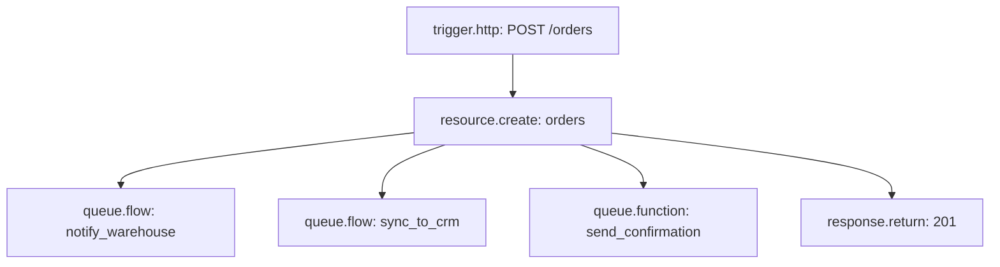

## Offload slow dependencies

Do the work the caller needs now, then dispatch everything else.



All three dispatches complete before the response is sent, but none waits for its job to finish. The order is stored, the caller has their 201, and the follow-ups run independently.

## Fan out a large list

A flow that loops over 10,000 records in one run will hit its time limit. Split the list and dispatch one job per chunk.

```json
{
  "id": "each_chunk",
  "data": { "block": "control.foreach", "config": { "items": "{{ steps.chunk_records.output }}" } }
}
```

Inside each iteration:

```json
{
  "id": "dispatch_chunk",
  "data": {
    "block": "queue.flow",
    "config": { "flow": "process_chunk", "input": { "records": "{{ item }}" }, "queue": "bulk" }
  }
}
```

Use a dedicated `bulk` queue so a large import cannot delay quick work. A chunk of 50 to 200 records is a good start: small enough to finish fast, large enough that dispatch overhead stays low.

## Idempotent jobs

Because a job can run twice (a manual retry, a replay after an outage), guard side effects.

<Steps>
  <Step title="Choose a key">
    Pick something that identifies the unit of work, such as the order id.
  </Step>
  <Step title="Check before acting">
    Look the key up first. If it is there, stop.
  </Step>
  <Step title="Act, then record">
    Do the work, then store the key so the next run sees it.
  </Step>
</Steps>

```json
{ "id": "already_done", "data": { "block": "cache.get", "config": { "key": "receipt_sent:{{ input.order_id }}" } } }
```

Prefer a durable marker over a cache entry when the work matters: a `receipt_sent_at` column on the order survives anything and doubles as a record. Check it with a `resource.get` and a branch.

## Report progress to the user

For work a user waits on, keep the state in a record, not in the job:

1. Create a `reports` row with `status: "preparing"` and dispatch the job.
2. The job updates the row to `ready` with a file link, or `failed` with a message.
3. The app reads the row, or listens for changes over [realtime](/realtime/overview).

This keeps the user interface correct even if the job is retried, replayed or lost from the log.

## Troubleshooting

<AccordionGroup>
  <Accordion title="A dispatched job never starts">
    Check the flow exists and is enabled, and that the queue name is spelled the way you dispatched it. List jobs with `status: "queued"` to see whether it is waiting. A `delay` keeps a job queued until the delay has passed.
  </Accordion>
  <Accordion title="The job fails at once and is not retried">
    A job gets one attempt by default. Add a `control.retry` block around the step that fails for passing reasons. See [lifecycle and retries](/jobs/lifecycle-and-retries).
  </Accordion>
  <Accordion title="A replay duplicated side effects">
    A replay reuses the original input and cannot know what the first attempt completed. Make the job [idempotent](#idempotent-jobs) before replaying.
  </Accordion>
  <Accordion title="The queue keeps growing">
    Work is arriving faster than it finishes. Read a few jobs in the slow queue: if they are `retrying`, a dependency is failing. If they are all slow, move that work to its own queue so other work is not stuck behind it.
  </Accordion>
  <Accordion title="A delayed job ran late">
    A delay means not before. For work that must happen on time, use a schedule that picks up everything due.
  </Accordion>
</AccordionGroup>

## Related

<CardGroup cols={2}>
  <Card title="Schedules" icon="calendar-clock" href="/jobs/schedules">Time-based work.</Card>
  <Card title="Flows" icon="workflow" href="/flows/overview">Build the flow a job runs.</Card>
</CardGroup>
