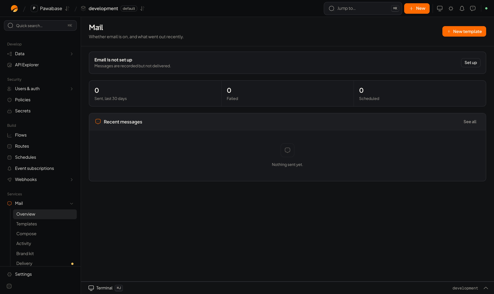
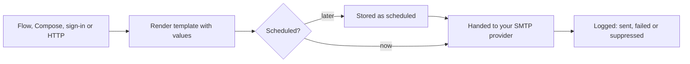

Mail sends the emails your product needs: sign-in codes and password resets, invitations, receipts, notifications, digests. Pawabase doesn't run a mail server of its own. It hands each message to **your** email provider (Resend, SendGrid, Mailgun, Postmark, Amazon SES, Gmail or any SMTP server), and keeps a record of everything it sent.

<Frame caption="Mail → Overview: what went out recently, failures, and whether delivery is set up.">
  
</Frame>

## What you get

| Capability | What it means for you |
| --- | --- |
| **Your provider, your domain** | Mail goes out through an SMTP provider you choose, from addresses on your domain. You can keep several providers saved and switch the default. |
| **Templates** | Design emails in a visual editor, fill them with values (`{{ order.id }}`), preview with sample data, send a test, and **publish**. Every publish is kept as a version you can restore. |
| **A brand kit** | Logo, colours, postal address and reusable blocks (headers, footers, signatures) shared by every template. |
| **Many ways to send** | From a [flow](/logic/flows) with the **Send email** block, by hand with **Compose**, from your server over HTTP, and automatically for sign-in emails. |
| **Scheduling** | Send now or at a set time, and cancel a scheduled message before it goes. |
| **Background delivery** | Messages from flows and sign-in are queued, so a slow provider never slows your app, and a failed attempt is retried. |
| **A full record** | Every message is logged with its recipients, what it said, the template and values it used, and what the mail server answered. Retry a failed one or send a copy. |

## How a message travels

1. Something asks for an email: a flow's **Send email** block, someone using **Compose**, your server, or the sign-in system (a verification code, a reset link).
2. If it names a **template**, the template's **published** version is filled in with the values you passed, plus your app's details from [Settings](/environments/settings#app-details).
3. If it has a send time in the future, it's stored as **scheduled** and sent then, exactly as it was rendered when you scheduled it.
4. Otherwise it's handed to the **default provider** of the environment.
5. The outcome is logged: **sent** (the provider accepted it), **failed** (it didn't), or **suppressed** (deliberately not sent, for example while delivery is paused).

## The pages in Studio

Open **Mail** in the sidebar.

| Page | Use it to | Docs |
| --- | --- | --- |
| **Overview** | See messages sent, failed, suppressed and scheduled over 7, 30 or 90 days, with recent messages and errors | this page |
| **Templates** | Create, design, organise, publish and restore templates | [Templates](/mail/templates) |
| **Compose** | Write and send one message now or later, with attachments | [Sending email](/mail/sending#compose) |
| **Activity** | Every message, with search, status filters, retry and cancel | [Mail activity](/mail/activity) |
| **Brand kit** | Brand styles, palettes, reusable blocks and folders | [Brand kit](/mail/brand-kit) |
| **Delivery** | Providers, sender addresses, pause | [Delivery](/mail/delivery) |

A dot next to **Delivery** means it still needs setting up. Until a provider is connected, Studio shows **Delivery is not set up: mail is recorded, not delivered**.

## Get set up

<Steps>
  <Step title="Connect your provider">
    **Mail → Delivery → Add provider.** Pick a preset (Resend, SendGrid, Mailgun, Postmark, Amazon SES, Gmail) or a custom SMTP server, paste the credentials and **Test connection**. See [Delivery](/mail/delivery).
  </Step>
  <Step title="Add a sender address">
    Add the addresses mail comes from, such as `orders@yourdomain.com`, and choose the default.
  </Step>
  <Step title="Fill in your app details">
    **Settings → App details**: app name, support email, postal address, website. Templates read them as `{{ app.name }}` and replies go to the support email.
  </Step>
  <Step title="Set your brand">
    **Mail → Brand kit**: logo and colours. See [Brand kit](/mail/brand-kit).
  </Step>
  <Step title="Make and publish a template">
    **Mail → Templates → New template.** See [Templates](/mail/templates).
  </Step>
  <Step title="Send it">
    Add a **Send email** block to a flow, or send from your server. See [Sending email](/mail/sending).
  </Step>
  <Step title="Check delivery">
    **Mail → Activity** should show it as *sent*. Then check the inbox, and the spam folder.
  </Step>
</Steps>

## Emails Pawabase sends for you

The sign-in system sends its own emails through the same delivery and brand: verification links and codes, sign-in links, password resets, invitations, and security notices. Choose their wording in [Email templates](/auth/email-templates). If delivery isn't set up, those emails are recorded but not delivered, so people can't verify or reset passwords. Set up delivery before you launch.

## Limits

| Limit | Value |
| --- | --- |
| Attachments per message | 10 MB in total |
| Emails per month | Depends on your plan: 500 on Free up to 200,000 on Scale. See [Plans and limits](/cloud/plans-and-limits). |
| What counts | Every delivery **attempt**, including retries, because your provider charges for each one |

Your provider has its own limits (sending rate, daily volume, attachment size). Those apply too.

## Where to go next

<CardGroup cols={2}>
  <Card title="Delivery" icon="send" href="/mail/delivery">Connect a provider and set senders.</Card>
  <Card title="Templates" icon="layout-template" href="/mail/templates">Design and publish emails.</Card>
  <Card title="Template language" icon="braces" href="/mail/template-language">Values, conditions, loops and filters.</Card>
  <Card title="Sending email" icon="mail-plus" href="/mail/sending">Flows, Compose, HTTP and scheduling.</Card>
  <Card title="Deliverability" icon="shield-check" href="/mail/deliverability">Stay out of spam.</Card>
  <Card title="Troubleshooting" icon="life-buoy" href="/mail/troubleshooting">When mail doesn't arrive.</Card>
</CardGroup>
