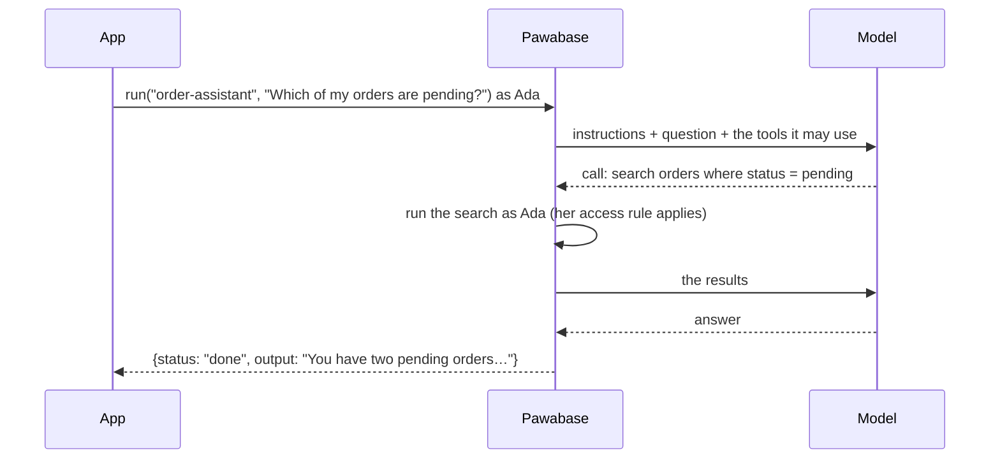

In about fifteen minutes you'll have an assistant that answers questions about your data ("Which of my orders are still pending?"), run from your server and from your app, and that sees **only what the person asking may see**.

An **agent** in Pawabase is a model plus instructions plus **tools**: tables it may search, flows it may run, apps it may use. It decides which tools to call, Pawabase runs them with the right permissions, and the agent answers. Every run is recorded step by step. [Agents](/ai/agents/overview) explains the model in depth; this page gets one working.

**You need:** a project with a table to ask about. The examples use `orders` with columns `status`, `total` and `owner_id`, where the owner field is `owner_id` and the access set-up is **Each user sees and changes their own records** (see steps 1–2 of the [JavaScript quickstart](/quickstarts/javascript) for how). You also need an API key from a model provider such as OpenAI or Anthropic.

## 1. Connect a model

1. In Studio open **Services → AI → Models** and click **Add models**.
2. Under **Who should run your models?**, choose your provider and **Connect a new provider**: paste its API key. Pawabase stores the key encrypted; it is never returned to Studio or sent to your app.
3. **Choose models**: tick one chat model and give it the **Model name** `chat`. Your code and agents refer to models by this name, not the provider's, so you can switch providers later without changing code.
4. Try it in **Playground**.

## 2. Make the agent

Open **Services → AI → Agents → New agent** and fill in:

| Field | Value | Why |
| --- | --- | --- |
| **Name** | `Order assistant` | Its identifier becomes `order-assistant` |
| **Thinks with** | `chat` | The model from step 1 |
| **What should it do?** | *You help customers with their orders. Look orders up before answering. Be brief.* | The instructions every run starts with |
| **Tools and access** | Add the `orders` table so it can search and open records | Without tools an agent can only talk |
| **Hold it to each person's own access** | On | The agent reads with the rights of the person who asked, never more |
| **Who may run it** | Signed-in users | Who may call it from an app |

Save, then **Ask it something**: *"Which orders are pending?"* and **Watch it work**: you'll see the agent decide to search `orders`, the search run, and the answer.

Asked from Studio, the agent runs with Studio's rights and sees every order. Asked by a signed-in person from your app, it sees only that person's orders, because the table's access rule applies to every search the agent makes on their behalf.

## 3. Run it from your app

<CodeGroup>
```typescript TypeScript
import { pawabase } from "./pawabase"; // the browser client, with a signed-in person

const run = await pawabase.ai.agents.run("order-assistant", "Which of my orders are still pending?");

if (run.status === "done") showAnswer(run.output);
else if (run.status === "waiting") askForApproval(run.pending);   // see step 5
else showError(run.error);
```

```python Python
pb = Pawabase(url, publishable_key, project=project).as_user(access_token)  # acting for the signed-in person

run = pb.ai.agents.run("order-assistant", "Which of my orders are still pending?")

if run["status"] == "done":
    print(run["output"])
elif run["status"] == "waiting":
    print("Needs approval:", run["pending"])
else:
    print("Failed:", run.get("error"))
```
</CodeGroup>

A run comes back as:

| Field | Meaning |
| --- | --- |
| `id` | The run's id: open it in Studio to see each step |
| `status` | `done`, `waiting` (stopped to ask permission), `failed`, or `running` (for background runs) |
| `output` | The answer, when there is one |
| `thread_id` | Pass it as `thread` on the next run to continue the conversation |
| `pending` | When `waiting`: what it wants to do and why |
| `error` | When `failed`: why |

### Conversations

Pass the previous run's `thread_id` to continue: the agent sees the earlier messages.

```typescript
const first = await pawabase.ai.agents.run("order-assistant", "Show my pending orders");
const next = await pawabase.ai.agents.run("order-assistant", "Cancel the oldest one", { thread: first.thread_id });
```

### Streaming

Long answers feel faster when the words appear as they're written. `stream` yields each step: pieces of text, tool calls and their results, approval requests.

```typescript
for await (const event of pawabase.ai.agents.stream("order-assistant", "Summarise my orders this month")) {
  if (event.type === "text") append(event.text);
}
```

## 4. Run it from a server

Background work (a nightly digest, triaging a support inbox) runs from a server with a **secret key**. A secret key isn't a person, so an agent run with it is not limited by per-person rules: give such agents only the tools they need.

<CodeGroup>
```typescript TypeScript
const service = createClient({ url, project, apiKey: process.env.PAWABASE_SECRET_KEY!, environment: "production" });
const run = await service.ai.agents.run("order-assistant", "List orders stuck in 'pending' for over a week");
```

```python Python
service = Pawabase(url, os.environ["PAWABASE_SECRET_KEY"], project=project, environment="production")
run = service.ai.agents.run("order-assistant", "List orders stuck in 'pending' for over a week")
```
</CodeGroup>

## 5. Let it change things, safely

Reading is low-risk; changing data isn't. Give the agent a tool that changes things (a flow such as `cancel_order`, or write access to a table) and set **Before it changes anything** to ask first. The run then stops with `status: "waiting"` and lists in `pending` what it wants to do. Your app shows that to the person, and the run continues only after they approve it. See [Approvals and limits](/ai/agents/approvals-and-limits) and [Run from your app](/ai/agents/run-from-app).

Set limits too, under **Most steps**, **Most tokens**, **Most seconds** and **Most cost ($)**, so a confused agent can't loop or run up a bill.

## What happens in a run



The model never connects to your database and never sees your keys: it asks Pawabase to use a tool, and Pawabase decides whether that's allowed and with whose rights.

## When it goes wrong

| Symptom | Likely cause |
| --- | --- |
| "I can't look that up" | The agent has no tool for that table, or its instructions don't tell it to use one |
| It answers about other people's records | **Hold it to each person's own access** is off, or it's run with a secret key |
| `403` when running from the app | **Who may run it** doesn't include signed-in users, or the person isn't signed in |
| `failed` with a provider error | The provider key is wrong, out of credit or rate-limited; check **Models** |
| `failed` after many steps | It hit a limit (steps, tokens, time, cost); read the run's steps in Studio |

See [AI troubleshooting](/ai/troubleshooting).

## Next

<CardGroup cols={2}>
  <Card title="Knowledge" icon="book-open" href="/ai/knowledge/overview">Let it answer from your documents.</Card>
  <Card title="Tools" icon="wrench" href="/ai/agents/tools">Flows, other agents, connected apps.</Card>
  <Card title="Approvals and limits" icon="shield-check" href="/ai/agents/approvals-and-limits">Keep changes in a person's hands.</Card>
  <Card title="Models in your app" icon="sparkles" href="/ai/use-it">Chat and embeddings without an agent.</Card>
</CardGroup>
