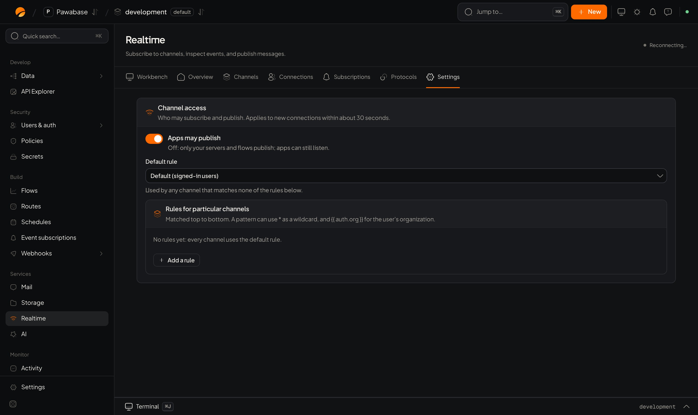
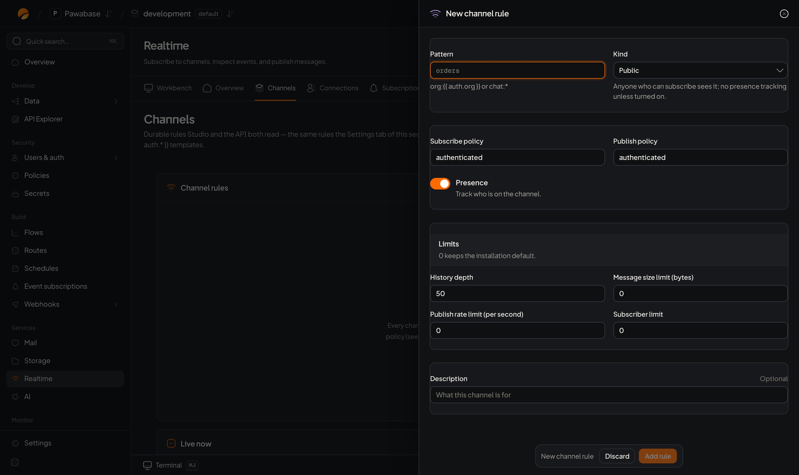

A **channel rule** applies to every channel whose name matches a pattern. It decides who can join, who can send, whether presence and history are on, and how much is allowed.

<Frame caption="Realtime → Settings: Apps may publish, the default rule and rules for particular channels.">
  
</Frame>

<Frame caption="Realtime → Channels → New channel rule.">
  
</Frame>

## Where

**Services → Realtime → Channels** (under **Configure**). The page is titled **Channel rules**: *Governs who can subscribe or publish, and whether messages are kept.* With no rules it says **No channel rules yet**. Click **Add rule**.

## The fields

| Field | Meaning |
| --- | --- |
| **Pattern** | Which channel names the rule covers. `*` is a wildcard. Placeholders insert facts about the caller: `org:{{ auth.org }}` matches only the channel for their organization, `user:{{ auth.user_id }}` only their own |
| **Kind** | What sort of channel it is (below) |
| **Subscribe policy** | Who may join, chosen in the [rule picker](/policies/rule-references). Placeholder: `authenticated` |
| **Publish policy** | Who may send |
| **Presence** | *Track who is on the channel* |
| **History depth** | How many recent messages to keep for latecomers |
| **Retention (seconds)** | For durable channels: how long a message is kept before it is purged |
| **Message size limit (bytes)** | Largest message |
| **Publish rate limit (per second)** | How often one sender may publish |
| **Subscriber limit** | The most people on one channel |
| **Description** | *What this channel is for* |

### Kinds

**Kind** labels what a channel is for. Only **Durable** changes how the channel behaves; the other kinds are names for your team, and the behaviour comes from the fields you set:

| Kind | Effect | Set these fields to get the behaviour the name suggests |
| --- | --- | --- |
| **Durable** | Every publish is also written to the database, so history survives a restart, and messages are kept for **Retention** | **History depth** for how many a client may read back |
| **Public** | A label | **Subscribe policy** *Anyone (public)* or *Signed-in users* |
| **Private** | A label | A **Pattern** with a placeholder, such as `user:{{ auth.user_id }}`, so only its owner can open it |
| **Presence** | A label | **Presence** on |
| **Protected** | A label | **Publish policy** *Secret keys & Studio*, so only your server sends |
| **Ephemeral** | A label | **History depth** 0, so nothing is kept for replay |

Studio's hint under **Kind** describes the intended use; it doesn't change the other fields for you. A new rule has **Presence** on and a **History depth** of 50 unless you change them.

Without **Durable**, history is kept in the server's memory: up to **History depth** messages per channel, within an overall memory budget, and lost when the server restarts.

## Rules are matched top to bottom

*Matched top to bottom.* The first rule whose pattern fits the channel name applies. Put specific patterns above general ones (`chat:staff-*` above `chat:*`). A channel that matches no rule uses the **default rule** (below).

## Examples

| Goal | Pattern | Kind | Subscribe | Publish |
| --- | --- | --- | --- | --- |
| Public announcements from your server | `announce:*` | Protected | Signed-in users | Secret keys & Studio |
| Staff room | `ops:*` | Presence | Users with role `staff` | Users with role `staff` |
| A channel per organization | `org:{{ auth.org }}` | Presence | Signed-in users | Signed-in users |
| A private inbox per person | `user:{{ auth.user_id }}` | Private | Signed-in users | Secret keys & Studio |
| Chat rooms with history | `chat:*` | Presence, history 100 | Signed-in users | Signed-in users |
| Orders feed that survives restarts | `orders:*` | Durable, retention 86400 | Role `staff` | Secret keys & Studio |

Because the placeholder `{{ auth.user_id }}` is filled with the caller's own id, a person can open only their own inbox. No code is needed to enforce it.

## Settings page

**Services → Realtime → Settings** is a simpler view of the same idea. *Who may subscribe and publish. Applies to new connections within about 30 seconds.*

| Setting | Meaning |
| --- | --- |
| **Apps may publish** | Off: *only your servers and flows publish; apps can still listen.* With it off, `send()` and `publish()` from a publishable key are refused whatever a rule says |
| **Default rule** | *Used by any channel that matches none of the rules below.* One rule for both listening and publishing. Unset: signed-in users. Channels it covers have presence on and keep 50 messages |
| **Rules for particular channels** | A list of rules, *matched top to bottom*. Each has a **Channel pattern** (`*` as a wildcard, `{{ auth.org }}` or `{{ auth.user_id }}` for the caller), **Who can listen**, **Who can publish**, **Show who is here** and **Messages kept for latecomers**. **Remove rule** deletes one |

The rules here and under **Channels** are the same list. Use **Channels** when you also need a kind, retention, size and rate limits, or a subscriber limit.

## When a rule takes effect

New rules and changes apply to new connections within about 30 seconds. A person already subscribed isn't dropped; they hit the new rule on their next join.

## What your app sees

`subscribe()` or `send()` throws a `RealtimeError` when a rule refuses. Test with the [Playground](/realtime/playground) and by acting as a person who should be refused; find the decision in **Activity**.

<CardGroup cols={2}>
  <Card title="Rules on realtime" icon="shield" href="/policies/realtime">Rule recipes.</Card>
  <Card title="Playground" icon="play" href="/realtime/playground">Test a rule.</Card>
</CardGroup>
