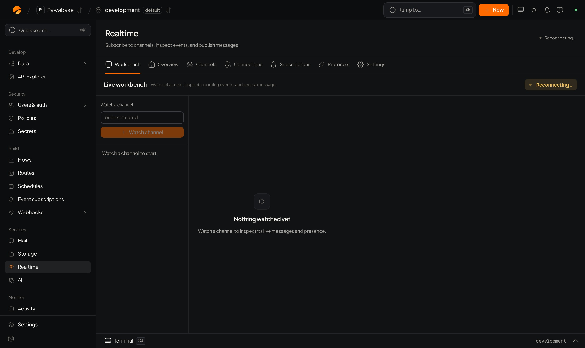

## Overview

<Frame caption="Services → Realtime → Overview.">
  
</Frame>

**Services → Realtime → Overview** (under **Monitor**). A **Live now** panel with the current connection state, and live counts:

| Card | Meaning |
| --- | --- |
| **Connections** | Sockets and streams open right now |
| **Active channels** | Channels with at least one subscriber |
| **Published** | Messages sent in this period |
| **Delivered** | Messages handed to subscribers (more than published when channels have many listeners) |
| **Dropped** | Messages that couldn't be delivered (a slow or gone subscriber) |

Below, **Active channels** lists each channel with its **Subscribers** and a **Watch** action. If none: *No active channels. Watch one by name above, or subscribe from a client.*

What to look for:

- **Dropped** rising: slow consumers or a flapping network.
- **Connections** much higher than your user count: clients that don't unsubscribe or reconnect in a loop.
- **Published** with no **Delivered**: nobody is listening, or a rule is refusing subscribers.

## Channels

**Services → Realtime → Channels** shows every channel in use. A channel is listed while someone is subscribed to it, and also after anything was published to it recently, even with no one listening.

The four figures at the top are **Channels with subscribers**, **Subscribers**, **Messages since start** and **Rules**. The **In use** list has **Channel, Subscribers, Present, Messages, Delivered** and **Last activity**, and **Find a channel** filters it by name. The counts start when the realtime server starts.

Click a channel to open it:

| Tab | What it shows |
| --- | --- |
| **Subscribers** | Every connection on the channel now: who, their role, when they connected, how many messages they sent, how many are waiting to reach them, and where from. **Remove** takes one person off; **Remove everyone** clears the channel. They stay connected and are told with a `channel_closed` message; the SDKs report it as a `closed` event and don't rejoin by themselves |
| **Messages** | The channel's recent messages, newest first, and **Send a message** to publish one as your servers would |
| **Presence** | Who has announced themselves, with what they shared and since when |
| **Rule** | The rule that governs the channel, or *Using the environment's default policy*, with **Edit rule** or **Add a rule for this channel** |

**Watch in the workbench** opens the channel in the live workbench.

A large **Waiting** number on a subscriber means a slow client: messages are queuing for it.

## Connections

**Services → Realtime → Connections.** *Every socket and SSE stream open to this environment right now.* Columns: **Connection, User, Protocol, Channels, Since.** If nobody is connected it says **Nobody is connected.**

Use it to answer "is my user connected?" and to spot a runaway client.

## Alerts

Don't stare at charts. Set an alarm on the numbers that matter (connections, dropped messages) under **Activity**, so you're told.

## From your app

```typescript
pawabase.realtime.status;                  // open | reconnecting | …
const members = await pawabase.realtime.presence("chat:lobby");   // who is on a channel right now
```

<CardGroup cols={2}>
  <Card title="Playground" icon="play" href="/realtime/playground">Watch a channel by hand.</Card>
  <Card title="Troubleshooting" icon="wrench" href="/realtime/troubleshooting">When numbers look wrong.</Card>
</CardGroup>
