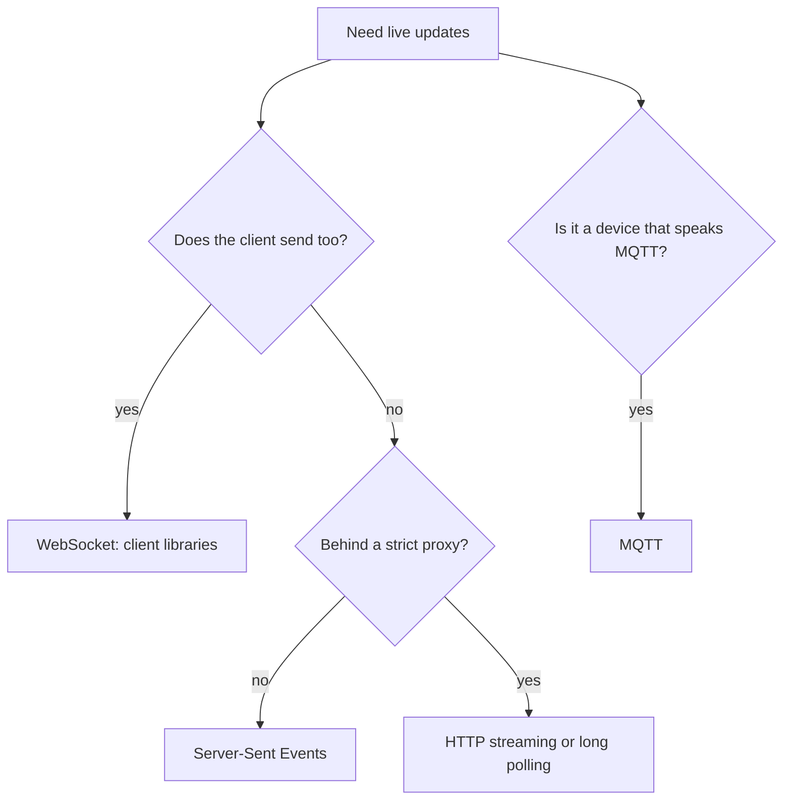

**Services → Realtime → Protocols** (under **Configure**) lists *what a client can connect with today*.

| Protocol | Direction | Use it for |
| --- | --- | --- |
| **WebSocket** | Both ways | Chat, presence, collaboration. What the client libraries use by default |
| **Server-Sent Events** | Server to client | One-way live updates over plain HTTP; dashboards, server listeners |
| **HTTP streaming** | Server to client | Environments where SSE is blocked |
| **Long polling** | Both (slowly) | A fallback for very restrictive networks |
| **MQTT** and **MQTT over WebSocket** | Both | Devices and IoT clients that already speak MQTT |

Each row shows its address and whether it's available.

## Which to choose

## Using the client libraries

You don't pick a protocol by hand with the client libraries:

- `pawabase.realtime.channel(...).subscribe()` uses WebSocket.
- `pawabase.realtime.stream(...)` (`pb.realtime.sse(...)`) uses Server-Sent Events.
- `pawabase.realtime.publish(...)` is a plain HTTP call.

## Other languages and devices

Anything that can open a WebSocket, an SSE stream or an MQTT connection can use realtime. Authenticate with your **publishable key** and, for a signed-in person, their **access token**; the same channel rules apply whatever the protocol. Copy each protocol's address from the Protocols page.

<CardGroup cols={2}>
  <Card title="Connection" icon="plug" href="/realtime/connection">Client behaviour.</Card>
  <Card title="Channel rules" icon="shield-check" href="/realtime/channel-rules">Rules apply to every protocol.</Card>
</CardGroup>
