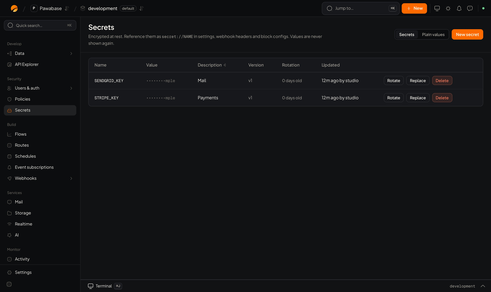

A **secret** is a value you don't want in your code or in a screenshot: a payment key, an email provider password, a webhook signing key. Store it in Pawabase and refer to it by name.

<Frame caption="Secrets: the names, versions and last change; values stay hidden.">
  
</Frame>

## Add one

1. **Secrets → New secret.**
2. Give it a **name** in capitals (for example `STRIPE_API_KEY`).
3. Paste the **value** and an optional description.
4. Save.

Values are **encrypted** and **never shown again**. Studio shows only that a value exists, its version, and when it last changed. You can still **Replace** it with a new value.

## Use one

Refer to it by name wherever a value is expected:

| Where | How |
| --- | --- |
| **A flow block or setting** | Write `secret://STRIPE_API_KEY` where the value goes, so the key is never in the flow |
| **A webhook header** | Use `secret://NAME` in an extra header, such as `Authorization` |
| **A connection** | Each [connection](/ai/apps/overview)'s key is kept as a secret |
| **Mail delivery** | Your SMTP password is stored the same way |

Because secrets live in the environment, `development` and `production` can each hold their own value under the same name, and your flows work in both unchanged.

## Rotate

**Rotating** replaces the value and **keeps the old one**, so a mistake can be undone with **Restore the value this secret had before its latest change**. Update the other side (your provider, a client) as you rotate.

Set **Rotate every (days)** to have Studio show a secret as **due for rotation** after that many days. Leave it empty for none.

## Plain values

The **Plain values** view next to **Secrets** holds settings your app reads that are *not* secret, such as a store name or a feature switch. Anything private belongs in Secrets.

## What is not copied

Secrets are never copied by [promote](/environments/promote), included in [backups](/backups/overview), or exported. Add them in each environment.

## Good practice

- Name them for what they are (`STRIPE_API_KEY`), not who made them.
- Use a different value per environment. Test keys in development.
- Rotate when someone who knew a value leaves.
- Don't paste secrets into flow inputs, logs or support messages.
