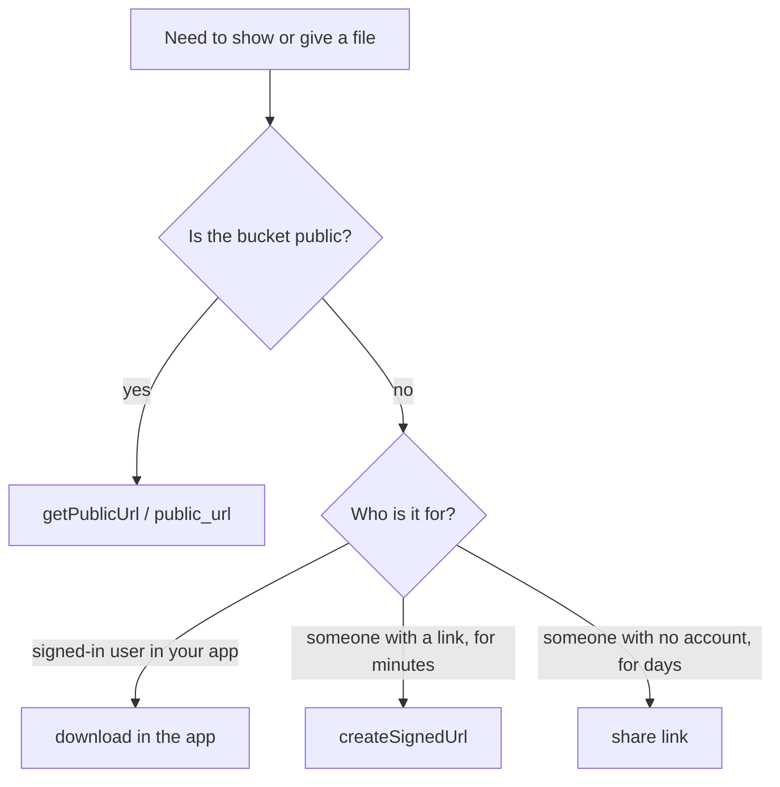

Storage keeps the files your app handles: avatars, documents, exports, attachments. You work with it through `pawabase.storage` (`pb.storage` in Python). Files live in **buckets**, and each file has a **key**, its path inside the bucket, such as `7/avatar.png`.

## Get started

Create a bucket once (a server task, shown on [Buckets](/storage/buckets)), then upload and read from your app.

<CodeGroup>
```typescript TypeScript
import { createClient } from "@pawabase/client";

const pawabase = createClient({ url: "https://api.example.com", apiKey: "pb_pk_…" });
const avatars = pawabase.storage.from("avatars");

// Upload a file the user picked
await avatars.upload("7/avatar.png", file);

// Show it (public bucket)
const src = avatars.getPublicUrl("7/avatar.png");

// Or give out a link that expires in 10 minutes (private bucket)
const { url } = await avatars.createSignedUrl("7/avatar.png", { expiresIn: 600 });
```

```python Python
from pawabase import Pawabase

pb = Pawabase("https://api.example.com", "pb_pk_…")
avatars = pb.storage.from_("avatars")

# Upload a file
avatars.upload("7/avatar.png", open("avatar.png", "rb"), content_type="image/png")

# Show it (public bucket)
src = avatars.public_url("7/avatar.png")

# Or give out a link that expires in 10 minutes (private bucket)
url = avatars.create_signed_url("7/avatar.png", expires_in=600)["url"]
```
</CodeGroup>

## The ideas

| Idea | What it means |
| --- | --- |
| Bucket | A named container with its own rules: who can read, who can write, what types and sizes it accepts. You usually have a few: `avatars`, `documents`, `exports`. |
| Key | The file's path inside the bucket. Slashes make "folders" you can list by prefix. Uploading to an existing key replaces the file. |
| Public bucket | Anyone with a file's URL can read it. Good for avatars and product images. Writing is still controlled. |
| Private bucket | Reading needs a signed-in user the bucket's rules allow, or a temporary link you hand out. |
| Signed URL | A temporary link to one file, with no key or sign-in needed. It expires. |
| Share link | A longer-lived, revocable link for people with no account. |

## Which way to read a file



## Where to go next

<CardGroup cols={2}>
  <Card title="Buckets" icon="folder" href="/storage/buckets">Create a bucket and set its type, size and public setting.</Card>
  <Card title="Uploading" icon="cloud-upload" href="/storage/uploading">Upload from the browser or a server, including straight-to-storage uploads.</Card>
  <Card title="Downloading and listing" icon="cloud-download" href="/storage/downloading">Read files, list them, build links and delete.</Card>
  <Card title="Access rules" icon="shield-check" href="/storage/access">Decide who may read and write a bucket.</Card>
  <Card title="Share links" icon="link" href="/storage/share-links">Revocable links for people without accounts.</Card>
  <Card title="Images" icon="image" href="/storage/images">Resize and convert images in the URL.</Card>
</CardGroup>
