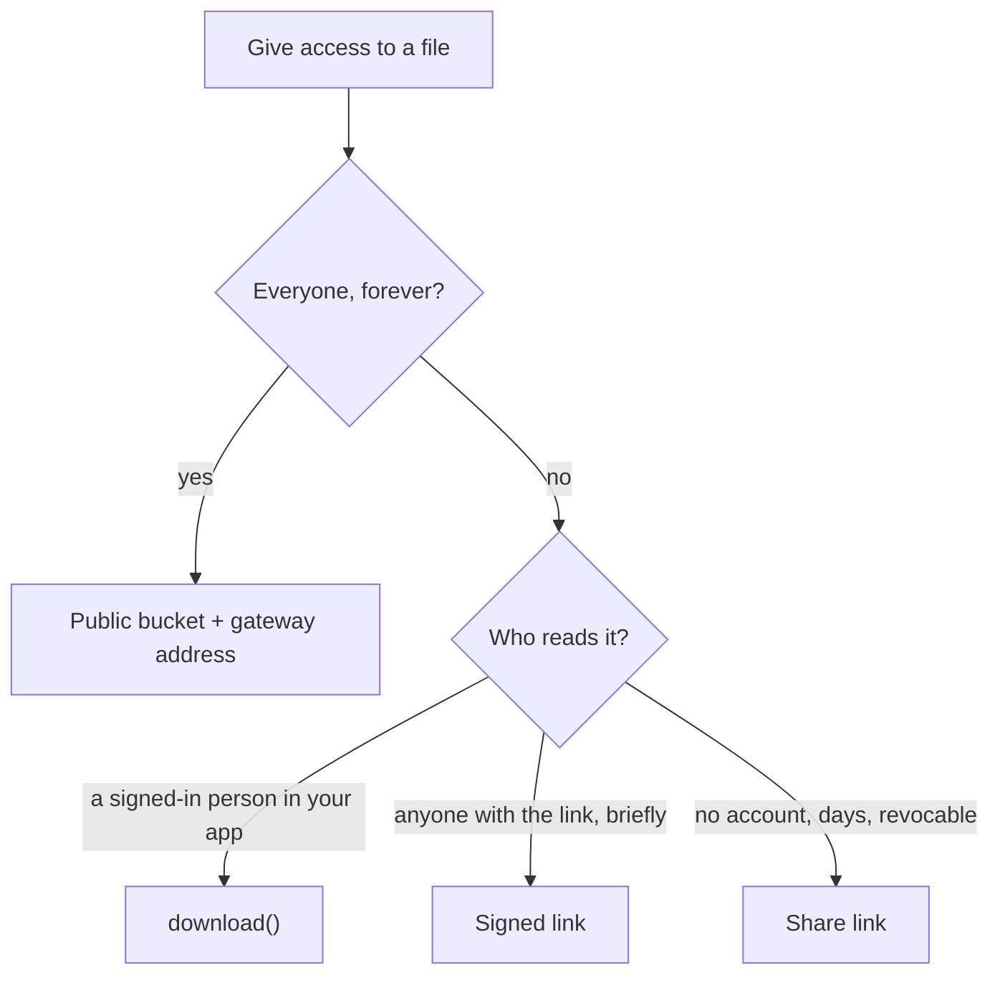

A file in a bucket can reach people in five ways. Pick by **who** reads it and for **how long**.

| You need | Use | Lasts | Needs |
| --- | --- | --- | --- |
| Show a file to everyone, in `` or a page | The [gateway address](#the-gateway-address) of a public bucket | Forever | **Public bucket** on |
| A signed-in person reads a private file in your app | [`download()`](#read-it-in-your-app) | One request | The read rule lets them |
| Anyone holding a link, without signing in, for minutes | A [signed link](#signed-links) | 1 second to 7 days | Signed downloads allowed on the bucket |
| Someone with no account, for days, with a way to cancel | A [share link](#share-links) | 1 minute to 1 year | A secret key, or Studio |
| A resized version of an image | Any of the above, with [transform options](/storage/images) | the same | Transformations on |



## The gateway address

Every file has one stable address on your gateway:

```
https://<gateway>/storage/v1/files/<environment>/<bucket>/<key>
```

It doesn't change when the file is replaced, and it doesn't depend on where the bytes are stored. You get it:

- in the answer to an upload: `stored.url`;
- on every file in a listing: `file.url`;
- in Studio: open the file, **Overview → Address → Gateway URL**;
- from Python's `public_url(key)`.

The address carries no key. Who may open it is decided by the bucket:

- **Public bucket** on: anyone, so it works in ``, emails and other sites.
- Otherwise the bucket's **Who may read** rule is checked for an anonymous visitor. A rule that needs a signed-in person refuses, because a browser loading an `` sends no token.

## Public URLs

Turn **Public bucket** on in the bucket's settings ([Bucket settings](/storage/bucket-settings)). Uploads, listing and deletes still follow their own rules; only reading becomes open.

<CodeGroup>
```typescript TypeScript
const avatars = pawabase.storage.from("avatars");

// after an upload
const { url } = await avatars.upload(`${user.id}/avatar.webp`, file);

// from a key you stored
const src = avatars.getPublicUrl(`${user.id}/avatar.webp`);
// 
```

```python Python
avatars = pb.storage.from_("avatars")
src = avatars.public_url(f"{user_id}/avatar.webp")
```
</CodeGroup>

The two SDKs build different addresses for the same file:

| | TypeScript `getPublicUrl(key)` | Python `public_url(key)` |
| --- | --- | --- |
| Address | `…/storage/v1/object/<bucket>/<key>?apikey=<publishable key>` | `…/storage/v1/files/<environment>/<bucket>/<key>` |
| Carries a key | The **publishable** key, which is meant to be public. A secret key is refused with `ConfigError` | None |

Both open the same file. Prefer the gateway address (`stored.url`, `file.url`) in TypeScript when you have it, because it's shorter and carries no key.

### Which host appears in the address

The gateway address is built on the environment's public address. When an environment has its own public URL set, such as a [custom domain](/environments/custom-domains), addresses use that host; otherwise they use the platform's.

## Read it in your app

For private files that a signed-in person may read, read through the SDK. Their session is sent and the bucket's rule decides.

<CodeGroup>
```typescript TypeScript
const blob = await pawabase.storage.from("documents").download(`${user.id}/contract.pdf`);
const objectUrl = URL.createObjectURL(blob);   // usable in , <iframe>, <a download>
// … later
URL.revokeObjectURL(objectUrl);
```

```python Python
data = pb.storage.from_("documents").download(f"{user_id}/contract.pdf")
```
</CodeGroup>

This holds the file in memory, which suits documents and images but not long videos. For those, use a signed link. See [Download and list](/storage/download).

## Signed links

A signed link lets anyone who holds it read **one file** for a short time, without signing in. Typical uses: a **Download** button for a private file, an image in an email, a video player that needs a plain URL.

<CodeGroup>
```typescript TypeScript
const { url, expires_at } = await pawabase.storage
  .from("documents")
  .createSignedUrl(`${user.id}/contract.pdf`, { expiresIn: 600 });

// <a href={url}>Download</a>
// add &download=Contract.pdf to save it with that name
```

```python Python
link = pb.storage.from_("documents").create_signed_url(f"{user_id}/contract.pdf", expires_in=600)
link["url"], link["expires_at"]
```
</CodeGroup>

| | |
| --- | --- |
| Lifetime | `expiresIn` / `expires_in` seconds: 1 to 604800 (7 days). Default 300 |
| Answer | `{ url, expires_at, method }`; `expires_at` is Unix seconds |
| Who may make one | Someone who may read the file themselves. You can't grant access you don't have (`403` "you may not grant access you do not have") |
| Bucket setting | Signed downloads are **off** by default. Turn them on with the bucket's `signed_downloads` setting in [infrastructure as code](/tools/iac/buckets) or the [management client](/tools/management-client). Otherwise: `403` "this bucket does not issue signed URLs for that" |
| After it expires | `404`. A signed link never says why it stopped working |
| Transformations | Add `&width=…` and the other [image options](/storage/images) to the link |

Make a fresh link when the page opens instead of storing one in a record: a stored link expires, and anyone who sees the record holds a working link until then.

Signed links have a twin for uploads: [signed upload links](/storage/upload#large-files-signed-upload-links).

### Signed links for many images

A gallery of private images can sign each address as it renders:

```tsx
function PrivateImage({ path }: { path: string }) {
  const [src, setSrc] = useState<string>();
  useEffect(() => {
    pawabase.storage.from("photos").createSignedUrl(path, { expiresIn: 3600 })
      .then(({ url }) => setSrc(`${url}&width=400&format=auto`));
  }, [path]);
  return src ?  : <div className="placeholder" />;
}
```

Each signature is a request. For a large gallery, consider a public bucket with unguessable keys, or sign on your server in one batch.

## Share links

A **share link** is for people with no account who need a file for longer: a client downloading a contract this week, a reviewer reading a draft. Unlike a signed link it can be **revoked**, has a label, and records how often it was opened.

| | |
| --- | --- |
| Lifetime | 1 minute to 1 year. Default 1 hour |
| Permissions | `view` (open in the browser), `download` (always saved as a file), or `both` |
| Address | `https://<gateway>/storage/v1/share/pbs_…` |
| After it ends | `410` "this link has expired" or "this link has revoked" |
| Made with | Studio, or a **secret** key |

### In Studio

Open the file in **Storage**, choose the **Sharing** tab, and create a link with a lifetime and permissions. The list shows every link, how often it was opened, and a **Revoke** button. See [Share links](/storage/share-links).

### From code

Share links are made with a **secret** key, on your server:

<CodeGroup>
```typescript TypeScript
import { createClient } from "@pawabase/client";
import { manage } from "@pawabase/client/manage";

const admin = manage(createClient({ url, apiKey: process.env.PAWABASE_SECRET_KEY!, environment }));

const share = await admin.buckets.createShare("contracts", "acme/2026-msa.pdf", {
  expiresIn: 7 * 24 * 3600,
  permissions: "download",
  label: "Acme legal review",
});
const all = await admin.buckets.shares("contracts");
await admin.buckets.revokeShare("contracts", share.id as string);
```

```python Python
bucket = admin.storage.from_("contracts")      # admin: a client with the secret key

share = bucket.create_share_link(
    "acme/2026-msa.pdf",
    expires_in=7 * 24 * 3600,
    permissions="download",
    label="Acme legal review",
)
bucket.list_share_links()
bucket.revoke_share_link(share["id"])
```
</CodeGroup>

Python's `create_share_link` refuses with `ConfigError` on a client without a secret key.

A share link reads the file **as the platform**, for that one file only, so the bucket's read rule doesn't apply to it. Deleting the file ends its share links. Replacing it keeps them, and they then show the new version.

## Compare

| | Gateway address (public bucket) | `download()` | Signed link | Share link |
| --- | --- | --- | --- | --- |
| Needs sign-in | No | Yes, or a rule that allows anonymous reads | No | No |
| Lasts | Forever | One request | Up to 7 days | Up to 1 year |
| Revocable | Make the bucket private | n/a | No, wait for it to expire | Yes |
| Counts opens | No | No | No | Yes |
| Works in `` and emails | Yes | Through an object URL | Yes | Yes |
| Made by | Anyone | Anyone allowed to read | Anyone allowed to read | Secret key or Studio |

## Security notes

- Anyone who has a signed or share link can use it until it ends. Treat links like passwords: don't log them, don't put them in pages others can see, and keep lifetimes short.
- A public bucket's addresses are only as secret as its keys. With keys like `1.png`, `2.png`, anyone can walk the bucket. Use random keys for anything not meant to be browsed.
- Files that could run script (HTML, SVG, JavaScript) are always sent as downloads, through any kind of link, so a link can't be used to run code on your domain.
- Share links don't depend on the bucket's rules, so revoke them when access should end, for example when someone leaves a project.

## Troubleshooting

| Symptom | Cause | Fix |
| --- | --- | --- |
| A public address answers `401` | The bucket isn't public, and its read rule needs a signed-in person | Turn **Public bucket** on, or use a signed link |
| `ConfigError` "Refusing to put a secret key in a URL" | `getPublicUrl` on a client with a secret key | Use the gateway address (`stored.url`), or a publishable key |
| `403` "this bucket does not issue signed URLs for that" | Signed downloads are off for the bucket | Set `signed_downloads` |
| `403` "you may not grant access you do not have" | The caller can't read the file themselves | Sign the link as someone who can, or with a secret key |
| A signed link answers `404` | It expired, or the file is gone | Make a new one |
| A share link answers `410` | It expired or was revoked | Make a new one |
| An image shows the old version | Browser cache on an unchanged address | Use a new key, or add `?v=` |

<CardGroup cols={2}>
  <Card title="Share links" icon="link" href="/storage/share-links">Studio steps.</Card>
  <Card title="Images" icon="image" href="/storage/images">Resize through any of these.</Card>
  <Card title="Bucket settings" icon="sliders-horizontal" href="/storage/bucket-settings">Public buckets and limits.</Card>
  <Card title="Who can do what" icon="shield-check" href="/storage/access">Read rules.</Card>
</CardGroup>
