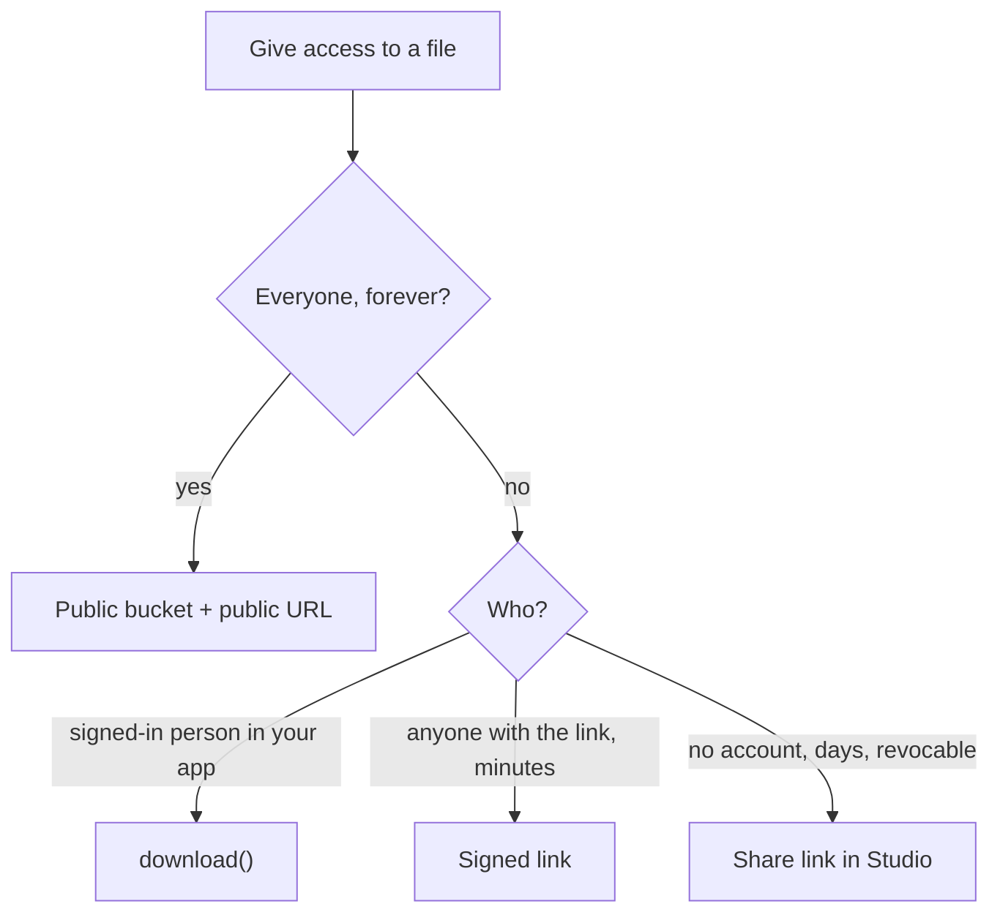

There are four ways to give someone (or an ``) access to a file. Pick by who the reader is and for how long.

| You need | Use | Lasts | Needs |
| --- | --- | --- | --- |
| Show a file to everyone on your site | **Public URL** | Forever | **Public bucket** on |
| A signed-in person reads a private file in your app | `download()` | The request | The read rule passes |
| Someone holds a link, no sign-in, for minutes | **Signed link** | Minutes | **Signed downloads** on |
| Someone with no account, for days, revocable | **Share link** | Hours to a year | Created in Studio |

## Public URL

Turn **Public bucket** on in the bucket's settings ([Bucket settings](/storage/bucket-settings)). Then:

<CodeGroup>
```typescript TypeScript
const src = pawabase.storage.from("avatars").getPublicUrl("7/avatar.png");
// 
```

```python Python
src = pb.storage.from_("avatars").public_url("7/avatar.png")
```
</CodeGroup>

In TypeScript the address carries your **publishable** key, which is designed to be public. A secret key is refused, so you can't leak one into a page by accident. The Python address is a gateway address that needs no key.

A private bucket answers "not found" to a public address; use one of the other kinds. You can copy a file's exact address in Studio: **file → Overview → Address → Gateway URL**.

## Signed link (minutes)

A signed link lets anyone who holds it read **one file** for a short time, with no sign-in. Turn on **Signed downloads** in the bucket's settings, then:

<CodeGroup>
```typescript TypeScript
const { url, expires_at } = await documents.createSignedUrl("7/contract.pdf", { expiresIn: 600 });
```

```python Python
link = documents.create_signed_url("7/contract.pdf", expires_in=600)
link["url"], link["expires_at"]
```
</CodeGroup>

You must be able to read the file yourself to sign it. The default lifetime is 300 seconds. Make a new link each time the page opens rather than storing one. Typical uses: a "Download" button for a private file, a link in an email.

## Share link (days, revocable)

For people with no account who need a file for longer, a **share link** can be revoked and shows how often it was opened. Create it in Studio: open the file, **Sharing** tab. See [Share links](/storage/share-links). Share links aren't created from the client library.

## Which to choose



## Security notes

- Anyone who has a signed or share URL can use it until it expires. Treat it like a password: don't log it, don't put it in a page others see.
- A public bucket's file addresses are guessable if keys are (`1.png`, `2.png`). Use random keys for anything not meant to be browsed.
- Replacing a file keeps its URL; deleting or moving it ends its share links.

<CardGroup cols={2}>
  <Card title="Share links" icon="link" href="/storage/share-links">Studio steps.</Card>
  <Card title="Images" icon="image" href="/storage/images">Resize through any of these.</Card>
</CardGroup>
