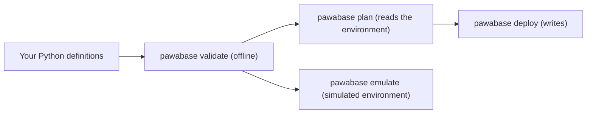

**Pawabase IaC** lets you write your backend instead of clicking it together. A table, a policy, a flow with branches and loops, a cron schedule: all of it is ordinary code you can review, test and keep in git.

<CodeGroup>
```bash Python
pip install pawabase-iac

pawabase init          # pawabase.toml, infra/app.py, .env.example
pawabase validate      # offline: every definition and every reference between them
pawabase emulate       # a pretend deploy: nothing real is touched, no key needed
pawabase plan          # what a deploy would change in the real environment (reads only)
pawabase deploy        # apply it; needs a deploy API key
```
</CodeGroup>

## Why use it

- **Everything is code.** Definitions are Python objects you can import, share and test.
- **Checked before it is sent.** Names, field types, constraints, policy conditions, flow graphs, template syntax, block settings and the references between all of them are validated on your machine, before anything is sent.
- **A plan before a change.** `plan` and `deploy --dry-run` show what would be created (`+`), changed (`~`, with the fields that differ) or removed (`-`).
- **Safe by default.** Pushing needs a secret API key; `merge` mode never deletes what your code doesn't mention; production asks first; secrets never sit in the code.

## What you can define

| Kind | Class | Read more |
| --- | --- | --- |
| Tables | `Table` | [Tables](/tools/iac/tables), [Fields](/tools/iac/fields), [Relations and indexes](/tools/iac/relations-and-indexes) |
| Reusable shapes | `Schema`, `Transformer` | [Schemas and transformers](/tools/iac/schemas-and-transformers) |
| Access | `Role`, `Policy` | [Roles](/tools/iac/roles), [Policies](/tools/iac/policies) |
| Logic | `Flow`, `Route` | [Flows](/tools/iac/flows), [Flow blocks](/tools/iac/flow-blocks), [Routes](/tools/iac/routes) |
| Events | `Subscription`, `Schedule`, `Webhook`, `InboundHook` | [Events and schedules](/tools/iac/events), [Webhooks](/tools/iac/webhooks) |
| Files | `Bucket` | [Buckets](/tools/iac/buckets) |
| Email | `MailTemplate` | [Mail templates](/tools/iac/mail-templates) |

Not managed from code yet: environment-level settings such as auth providers, API keys, firewall rules, domains, alarms and backup schedules. Do those in [Studio](/auth/overview). See [Limits](/tools/iac/limits).

## How it fits together



1. **Validate** checks everything offline.
2. **Emulate** rehearses a deploy against a simulated environment kept in a file. No server, no key.
3. **Plan** compares your code with the real environment and prints the differences.
4. **Deploy** applies them in dependency order.

## Learn it in this order

<Steps>
  <Step title="Get going">
    [Quickstart](/tools/iac/quickstart) and [Project files](/tools/iac/project).
  </Step>
  <Step title="Define data and access">
    [Tables](/tools/iac/tables), [Fields](/tools/iac/fields), [Policies](/tools/iac/policies), [Roles](/tools/iac/roles).
  </Step>
  <Step title="Define logic and events">
    [Flows](/tools/iac/flows), [Routes](/tools/iac/routes), [Events and schedules](/tools/iac/events), [Webhooks](/tools/iac/webhooks).
  </Step>
  <Step title="Ship it">
    [Validate](/tools/iac/validate), [Plan and deploy](/tools/iac/plan-and-deploy), [Emulate](/tools/iac/emulate), [CI/CD](/tools/iac/ci-cd).
  </Step>
</Steps>
