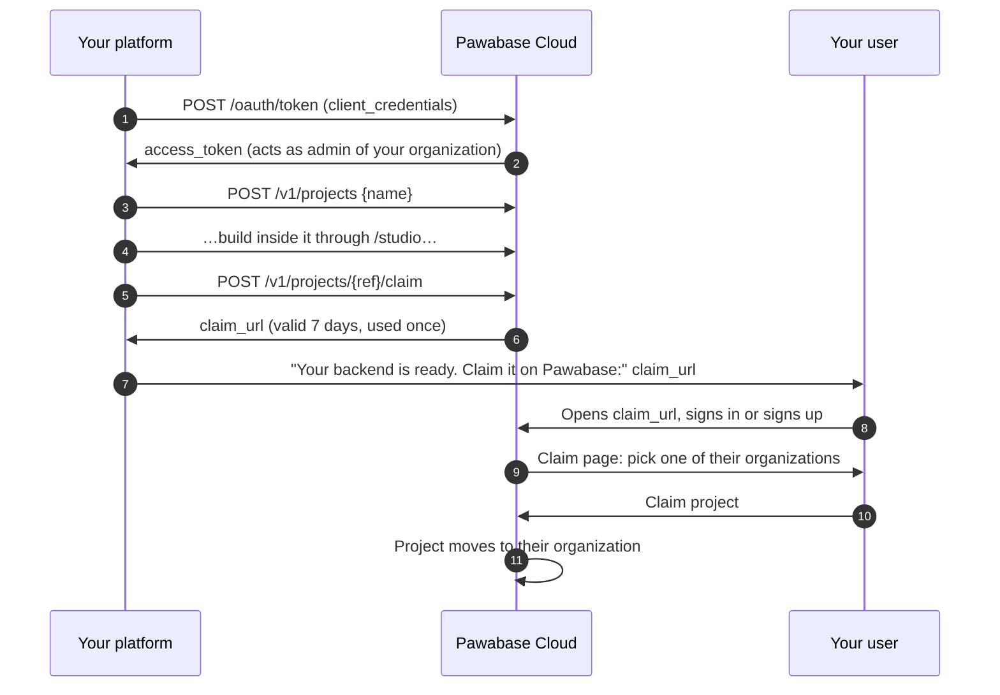

Some products want to give people a working backend **before** those people have a Pawabase account: an AI builder that makes an app from a prompt, a template gallery, a course platform that hands every student a project. For these, register a **platform app**.

A platform app can do everything an OAuth app can, plus two things:

1. **Act on its own organization without a person**, with the `client_credentials` grant. It creates and manages projects in the organization that registered it.
2. **Hand a project over** with a **claim link**. The person who opens it, signed in to Pawabase, moves the project into an organization of their own. Its data, address and keys stay as they are.



## Register a platform app

In **Settings → Integrations → Register app**, choose **Platform app** under **Type**. The type can't be changed later. Callback URLs are optional; add them if the same app also offers **Sign in with Pawabase**.

The projects your platform makes live in **your** organization until claimed, so they count against **your** plan's project allowance and bill to you. Pick a plan with room for the number of unclaimed projects you expect to hold at once.

## Get a token

`POST /oauth/token` with `grant_type=client_credentials` and the client id and secret:

<CodeGroup>
```typescript TypeScript
const PAWABASE = "https://dashboard.pawabase.com";
const basic = "Basic " + Buffer.from(`${process.env.PAWABASE_CLIENT_ID}:${process.env.PAWABASE_CLIENT_SECRET}`).toString("base64");

let cached: { token: string; until: number } | null = null;

export async function platformToken(): Promise<string> {
  if (cached && Date.now() < cached.until) return cached.token;
  const response = await fetch(`${PAWABASE}/oauth/token`, {
    method: "POST",
    headers: { "content-type": "application/x-www-form-urlencoded", authorization: basic },
    body: new URLSearchParams({ grant_type: "client_credentials", scope: "projects:write project:write" }),
  });
  const body = await response.json();
  if (!response.ok) throw new Error(body.error_description || body.error);
  cached = { token: body.access_token, until: Date.now() + (body.expires_in - 60) * 1000 };
  return cached.token;
}
```

```python Python
import os, time
import httpx

PAWABASE = "https://dashboard.pawabase.com"
_cached: dict = {}


def platform_token() -> str:
    if _cached and time.time() < _cached["until"]:
        return _cached["token"]
    response = httpx.post(
        f"{PAWABASE}/oauth/token",
        auth=(os.environ["PAWABASE_CLIENT_ID"], os.environ["PAWABASE_CLIENT_SECRET"]),
        data={"grant_type": "client_credentials", "scope": "projects:write project:write"},
    )
    body = response.json()
    if response.status_code != 200:
        raise RuntimeError(body.get("error_description") or body.get("error"))
    _cached.update(token=body["access_token"], until=time.time() + body["expires_in"] - 60)
    return _cached["token"]
```
</CodeGroup>

| Field | Required | Value |
| --- | --- | --- |
| `grant_type` | Yes | `client_credentials` |
| `client_id`, `client_secret` | Yes | As HTTP Basic, or in the body. The secret is **required** here: there is no PKCE without a person |
| `scope` | No | Space-separated scopes, each one the app may ask for. Left out: every scope the app may ask for |

The answer:

```json
{
  "access_token": "eyJhbGciOiJIUzI1NiIs…",
  "token_type": "bearer",
  "expires_in": 3600,
  "scope": "projects:write project:write",
  "organization": "your-company"
}
```

There is **no refresh token**. When the hour is up, ask again with the same request. Cache the token and reuse it across requests rather than asking for one per call.

Errors:

| Status | `error` | Cause |
| --- | --- | --- |
| 401 | `invalid_client` | Missing secret, wrong secret, or unknown client id |
| 400 | `unauthorized_client` | The app is an OAuth app, not a platform app |
| 400 | `invalid_scope` | A scope the app may not ask for |

### What the token can do

- It acts as an **admin** of the organization that registered the app (never owner), whatever scopes it holds. So it can create, change, pause and delete that organization's projects, and change what's inside them, if its scopes allow.
- `GET /v1/token` answers `"kind": "client"`, `"user": null`, and the app.
- Projects it creates show `created_by_email: "app:<client id>"` and `integration: {name, client_id}`.
- It stops working at once if the app is deleted. Rotating the secret doesn't end tokens already issued; they run out within the hour.

## Make and build a project

From here it is the ordinary [Management API](/tools/integrations/management-api) and [Studio API](/tools/integrations/project-api):

<CodeGroup>
```typescript TypeScript
const token = await platformToken();
let project = await pawabase(token, "POST", "/projects", { name: `${user.name}'s shop`, app: "storefront" });
while (project.state === "creating" || project.app?.state === "waiting" || project.app?.state === "installing") {
  await new Promise((r) => setTimeout(r, 3000));
  project = await pawabase(token, "GET", `/projects/${project.ref}`);
}
await db.projects.insert({ user_id: user.id, pawabase_ref: project.ref, claimed: false });
```

```python Python
token = platform_token()
project = pawabase(token, "POST", "/projects", {"name": f"{user.name}'s shop", "app": "storefront"})
while project["state"] == "creating" or (project.get("app") or {}).get("state") in ("waiting", "installing"):
    time.sleep(3)
    project = pawabase(token, "GET", f"/projects/{project['ref']}")
db.projects.insert(user_id=user.id, pawabase_ref=project["ref"], claimed=False)
```
</CodeGroup>

Keep your own record of which of your users each project is for: Pawabase doesn't know your users.

## Claim links

### `POST /v1/projects/{ref}/claim`

Scope `projects:write`. Only a platform app's own `client_credentials` token may call it; any other token is `403 forbidden` "Only a platform app, with its client credentials, can hand its projects over." The project must be in the app's organization.

<CodeGroup>
```typescript TypeScript
const link = await pawabase(await platformToken(), "POST", `/projects/${ref}/claim`);
await mail.send(user.email, "Your backend is ready", `Claim it on Pawabase: ${link.claim_url}`);
```

```python Python
link = pawabase(platform_token(), "POST", f"/projects/{ref}/claim")
mail.send(user.email, "Your backend is ready", f"Claim it on Pawabase: {link['claim_url']}")
```
</CodeGroup>

```json
HTTP/1.1 201 Created
{
  "claim_url": "https://dashboard.pawabase.com/claim?token=pbk_9fJk…",
  "token": "pbk_9fJk…",
  "expires_at": "2026-11-25T12:00:00+00:00"
}
```

| Rule | Value |
| --- | --- |
| Lifetime | 7 days |
| Uses | One. After a project is claimed, the link answers `410` |
| Several links | Allowed: each call makes a new, independent link. The first one used wins; the others then fail because the project has left your organization |
| Stored as | A SHA-256 hash. Pawabase can't show a link again; make a new one |

The link is a bearer credential: whoever has it and is signed in can take the project. Send it only to the person it is for, over a channel you trust (your own app, their verified email). Don't put it in public pages or URLs that get logged.

### What the person sees

1. **Signed out**: Pawabase's sign-in page, which brings them back to the claim page after they sign in. People without an account follow **Create an account**: they're signed in as soon as the account is made and land straight back on the claim page. The email-confirmation link they receive also leads back to it.
2. **The claim page**: "**Claim "\{project name\}"**", "\{Your app\} made this project for you. Move it into one of your organizations to own it: its data, address and settings stay as they are." Then a **Move it to** picker with the organizations where they are an **admin or owner**, and **Claim project**.
3. **No organization where they're admin**: the page asks them to create one (or become an admin of one) and open the link again.
4. **After claiming**: "It's yours", and **Open projects** takes them to the project list.

### What claiming does

The project **moves**; nothing is copied or rebuilt:

| Stays the same | Changes |
| --- | --- |
| The project's id, address (`slug`) and API URL | Its organization: now the person's |
| Every environment, table, record, file, flow, rule, user and secret | Its limits: now those of the person's plan |
| Its API keys (so the app you built for them keeps working) | It counts against the person's project allowance, no longer yours |
| Its marketplace app, if any | Your platform's token can no longer reach it: `404` |

Claiming is refused if:

| Answer | Cause |
| --- | --- |
| `410 claim_expired` | The link is older than 7 days, was used already, or the project was deleted |
| `409 not_ready` | The project is still creating (or failed) |
| `409 protected` | Deletion protection is on: it blocks moving too. Leave it off on projects you plan to hand over |
| `409 slug_taken` | The person's organization already has a project with the same address (very unlikely: addresses carry random characters) |
| `402 plan_limit` | The person's plan has no room for another project. They upgrade, or delete one, then open the link again (it is still valid until used or expired) |
| `403 forbidden` | They aren't an admin of the organization they picked |

Both organizations' activity logs record the move: `project.transferred_out` in yours and `project.transferred_in` in theirs. Yours also has `integration.claim_link` for each link made.

### After the claim

Your platform loses access to the project. To keep working on it for the person (say, your builder keeps editing their app), ask them to **Sign in with Pawabase** in your product: an ordinary OAuth connection to their organization, with their consent. Their claimed project is then reachable with that connection's token, by the same `ref`.

A good flow:

1. Your user builds an app in your product; you make the project on your platform token.
2. You show "Claim your backend" with the claim link.
3. When they come back from claiming, you show "Keep editing with \{your product\}: Sign in with Pawabase".
4. From then on, you use their connection's token for that project.

Watch for the claim by checking `GET /v1/projects/{ref}` with your platform token: `404` means it has left your organization.

## Clean up what isn't claimed

Unclaimed projects keep counting against your plan. Decide how long to keep them and delete the rest with `DELETE /v1/projects/{ref}` on your platform token, for example a nightly job that deletes projects older than 30 days that were never claimed. Tell your users the deadline next to the claim link.

## Security notes

- The client secret of a platform app is more powerful than an OAuth app's: on its own, with no person, it can act as an admin of your organization. Keep it in a secret store, give it to as few services as possible, and [rotate it](/tools/integrations/register-an-app#rotate-the-secret) when anyone who had it leaves.
- Ask `client_credentials` for only the scopes each service needs: the service that sends claim links needs `projects:write`; the one that builds tables needs `project:write`.
- Keep projects you make for users in a dedicated organization, not the one your own production backend lives in. A leaked platform secret then can't touch your own projects.

Next: [Personal access tokens](/tools/integrations/personal-tokens).
