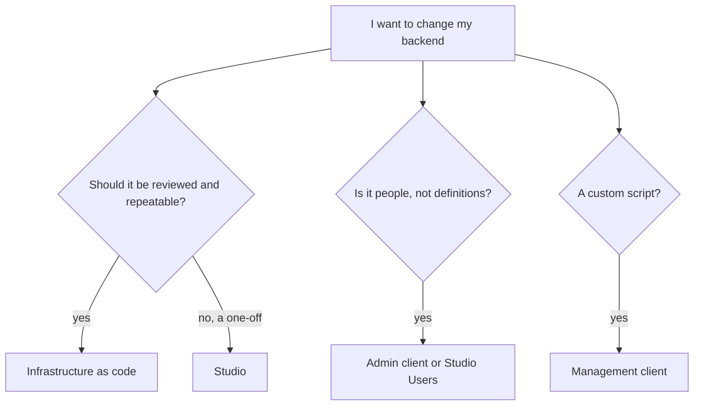

Studio is the fastest way to explore and change a project. **Tools** are for when you want changes to be **code**: reviewed in a pull request, repeatable across environments, and applied by a pipeline instead of by hand.

| Tool | What it does | Use it when |
| --- | --- | --- |
| [**Infrastructure as code**](/tools/iac/overview) | Describe a whole backend (tables, rules, flows, routes, schedules, webhooks, buckets, mail templates) as code, then validate, plan, emulate and deploy it | You want your backend in version control and deployed by CI |
| [**The `pawabase` command**](/tools/iac/commands) | `init`, `validate`, `plan`, `deploy`, `emulate`, `whoami` | Day-to-day work with IaC |
| [**Management client**](/tools/management-client) | Change environments and definitions from your own scripts, with a secret key | Custom tooling, seeding, one-off migrations |
| [**Admin client**](/tools/admin-client) | Manage users, roles, organizations and sessions from a trusted server | Back-office tools, onboarding scripts |
| [**CI/CD**](/tools/iac/ci-cd) | GitHub Actions workflows that validate on pull requests and deploy on merge | Automated releases |

<Note>
Infrastructure as code is available for **Python** today (`pawabase-iac`). Every example is written in a tab so a **TypeScript** tab can sit beside the Python one when that package ships; the concepts, commands and files are the same.
</Note>

## Studio and code are the same thing

A definition made in Studio and the same definition made in code are identical data. You can:

- **Start in Studio, move to code:** build something visually, then recreate it in code and use `pawabase plan` to confirm there are no differences.
- **Start in code:** deploy, then open Studio to see what was created and watch it run.
- **Mix:** keep some things (users, secrets, provider keys) in Studio and the rest in code. `merge` mode (the default) never deletes what your code doesn't mention.

## Which tool for which job

<CardGroup cols={2}>
  <Card title="Infrastructure as code" icon="file-code" href="/tools/iac/overview">Your backend, in Python.</Card>
  <Card title="Quickstart" icon="rocket" href="/tools/iac/quickstart">Deploy something in ten minutes.</Card>
  <Card title="Management client" icon="server" href="/tools/management-client">Scripts with a secret key.</Card>
  <Card title="CI/CD" icon="workflow" href="/tools/iac/ci-cd">Deploy on merge.</Card>
</CardGroup>
